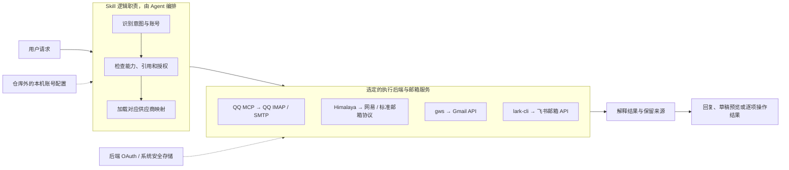
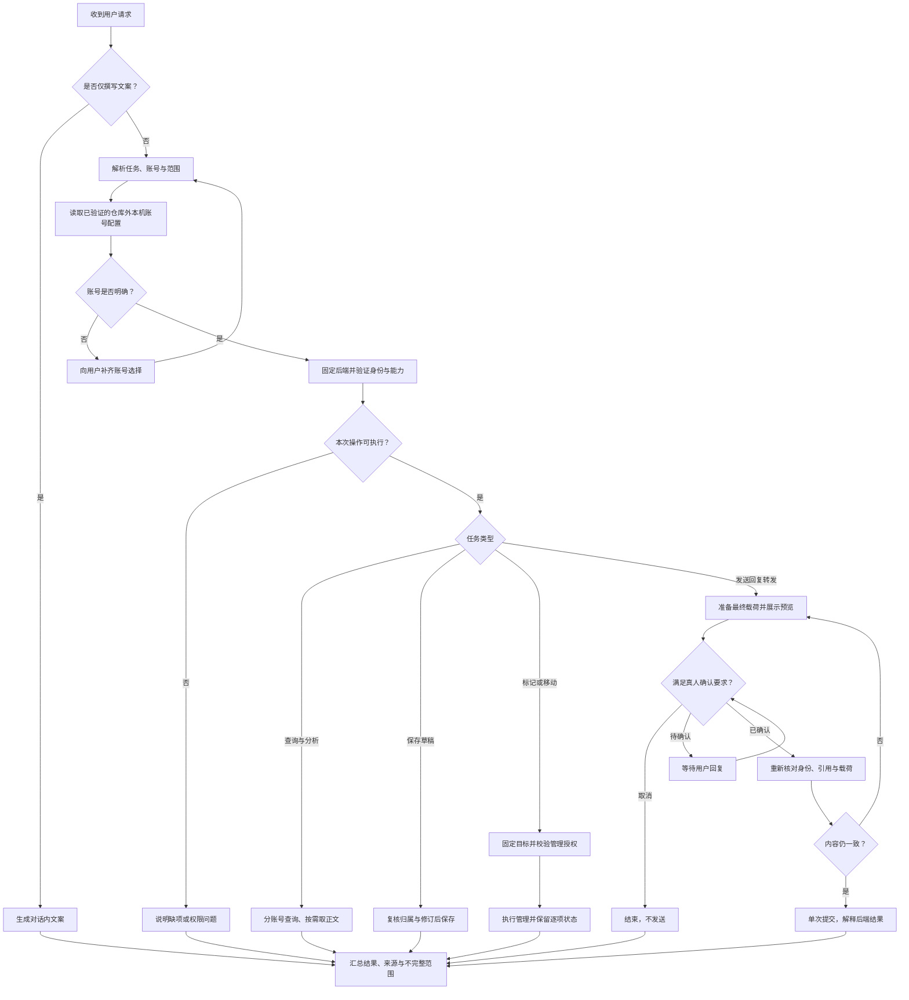
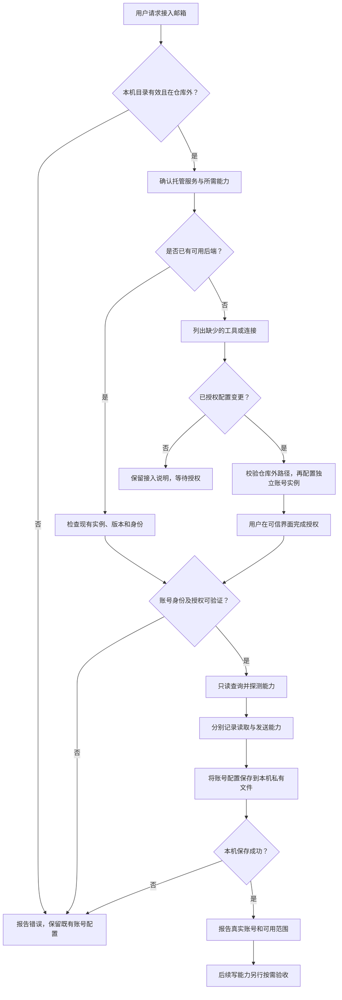
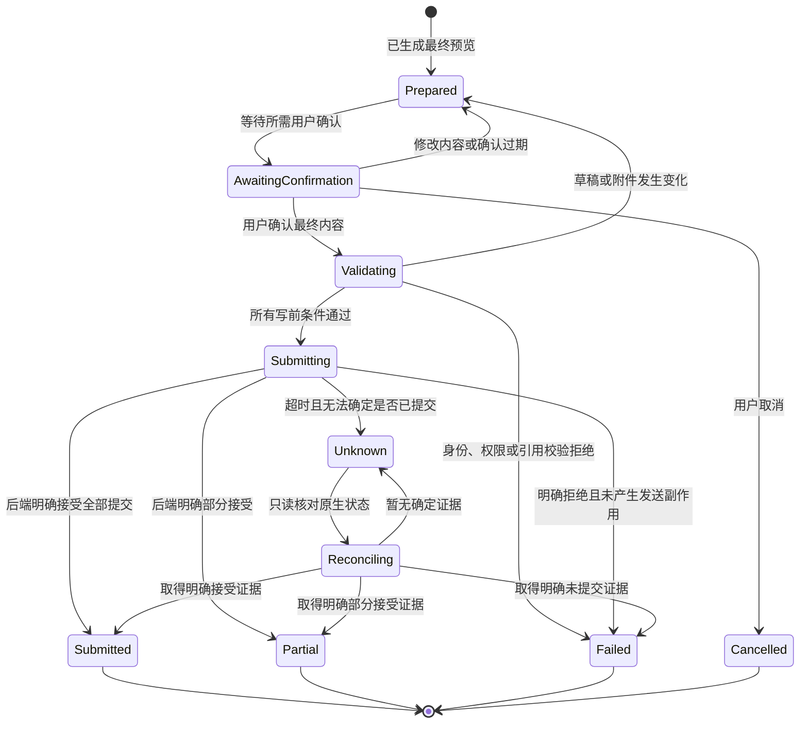
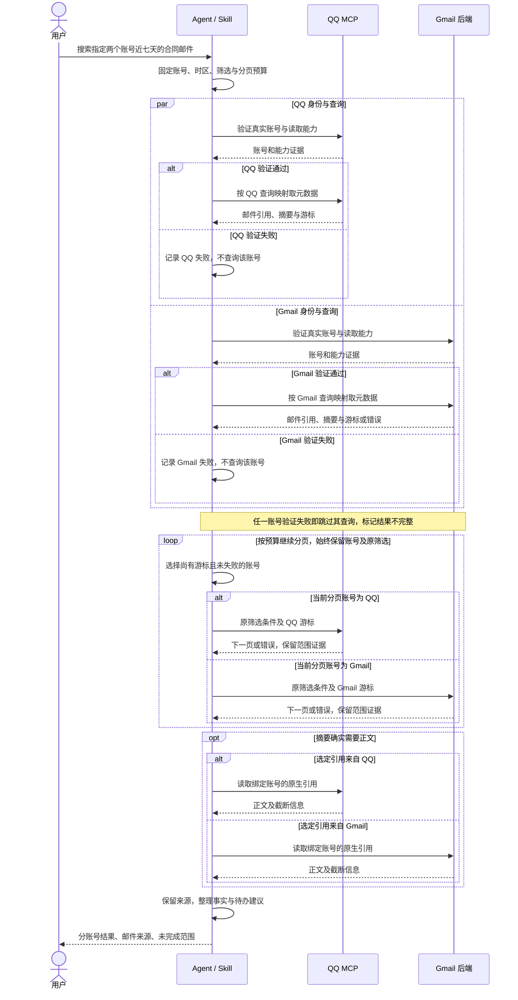
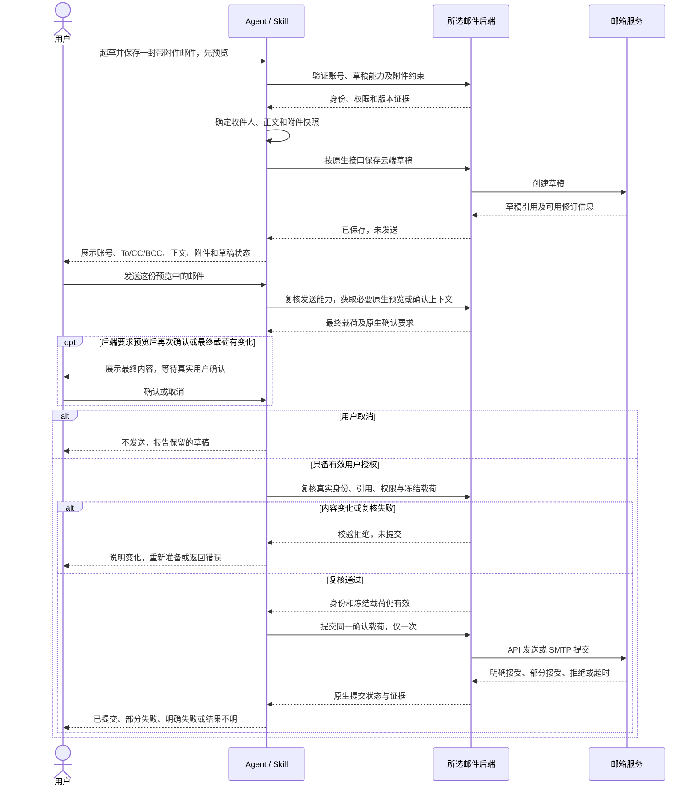
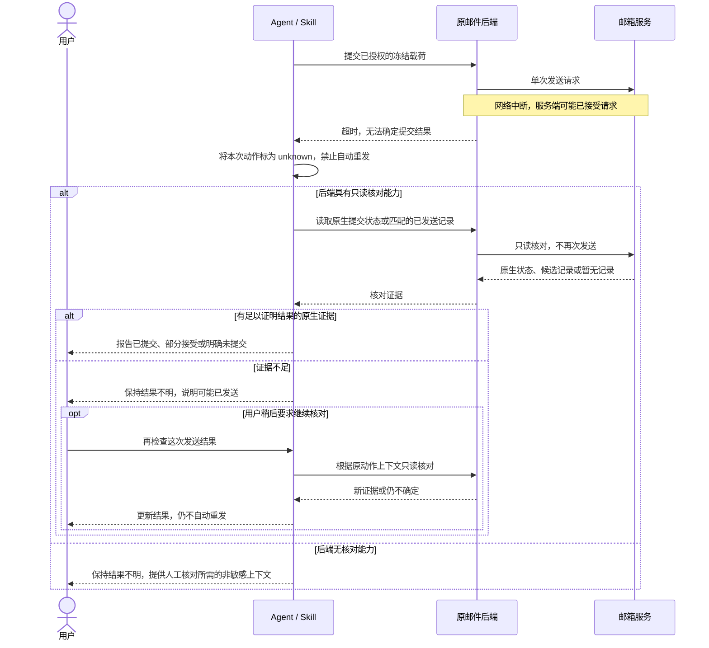

# 多邮箱 Skill 技术设计与业务流程

更新日期：2026-11-10（Asia/Shanghai）。配套主文档：[调研与实施方案](research-and-plan.zh-CN.md)。

本文描述待实施的技术方案，不代表已有统一邮件运行库、账号注册服务或可调用的公共接口。支持范围、上游版本和外部能力证据沿用主方案第二至五节及第十节；本文重点定义编排职责、业务规则、状态和验证边界。

**真实邮箱信息仅保存在本机，禁止提交 Git 或分发。账号配置需在仓库外持久化，换会话后从本机重新加载；邮件、附件和运行记录需要落盘时也只能写入本机私有目录。**

## 1. 技术架构

### 1.1 实现形态和技术选择

首期采用“可移植 Skill + 按供应商加载的参考文档 + 现有后端工具”。Agent 按说明完成任务拆解和路由，已有 CLI/MCP 完成协议、OAuth、MIME 和远端读写。下图的编排、策略、映射和结果处理是逻辑职责，不表示首期会开发四个独立服务。

| 层次 | 首期实现 | 职责与边界 |
| --- | --- | --- |
| 通用入口 | `SKILL.md` | 触发条件、任务类型、账号确定、能力判断和结果规则 |
| 后端适配说明 | `references/providers.md` 及供应商文档 | 固定版本的 CLI 参数/MCP schema、查询映射、权限前提和已验收能力 |
| 客户端适配 | 平台默认适配与必要的 Skill 专属 override | 发现可用连接、安装位置、MCP 配置和 UI 元数据；不把这些写入 portable core |
| 执行后端 | QQ MCP、Himalaya、gws、lark-cli；P2 增加其他后端 | 网络连接、邮件协议或平台 API、原生 ID 和远端状态 |
| 凭据设施 | 后端 OAuth 缓存、系统安全存储及受控的进程注入 | 用户本人完成交互授权；不向 Agent 返回密钥，不新建共享凭据仓库 |
| 本机配置与运行目录 | 仓库外的账号配置文件、后端原生配置及独立的状态/缓存目录 | 持久化账号选择和连接引用；真实信息不随 Skill 构建、Git 或同步分发 |
| 可选确定性辅助程序 | 仅在原生后端不能满足必要不变量时单独实现 | 如内容快照绑定或文件路径校验；必须有明确入口和测试，不用提示词声称获得进程级隔离 |

首期不新增 Web 服务、常驻调度器、中心账号数据库和跨邮箱全文索引。账号配置按第二节的本机文件约定持久化；任务对象仍以会话上下文为主，不自动持久化所有正文。后续代码化时需定义本地文件的校验、版本与迁移，不能把私有配置纳入 portable Skill。

### 1.2 架构图

虚线表示后端凭据依赖；不表示四个工具具有相同凭据实现。QQ 在 macOS 上的凭据问题仍按主方案第三节处理。后端返回的邮件内容只进入数据处理，不进入授权来源。

### 1.3 CLI 和 MCP 的执行约束

- CLI 使用固定版本的命令和结构化结果；有辅助程序时以参数数组调用进程，不把邮件主题、地址、查询或附件名拼接成可执行 shell 文本。仅能执行 shell 的 Agent 仍须正确引用参数，并优先使用后端支持的数据文件或标准输入。
- MCP 使用已连接实例的实际工具清单和 schema，先验证账号身份再调用。工具名称相同不代表连接了同一个账号。
- 同一任务固定账号和后端。读取阶段需要更换后端时重新校验账号、能力和原生引用；已经开始写入后禁止自动换后端重做。
- 配置任务可以验证读取连接；不得为了通过“完整就绪”检查自动扩大到发信权限。没有安装授权的普通查询只报告缺项，不自动安装、升级或改配置。
- 原生后端无法执行必要的身份校验、内容绑定或安全文件落地时，该项写入/下载能力保持不可用；可以展示对话内草稿或附件元数据，不能把提示词约束当作已实现的硬性保护。

## 2. 数据对象与边界

### 2.1 逻辑对象

以下字段用于统一理解和结果展示，不是已发布的 API、磁盘配置格式或数据库表。原生工具的参数和返回仍由供应商文档定义。

| 对象 | 核心字段 | 业务约束 |
| --- | --- | --- |
| `AccountContext` | `account_id`、`address`、`provider`、`backend`、`instance`、`backend_version` | 别名是选择入口；实际执行身份必须来自连接校验，禁止仅相信配置显示名 |
| `CapabilitySnapshot` | `supported`、`granted`、`observed_at`、`limits`、`evidence` | 分开记录工具支持与账号授权；用户当次许可单独判断。过期证据不能替代写前检查 |
| `MessageRef` | `account_id`、`instance`、`native_ref`、`folder`、`validity` | 原生引用不透明；账号/实例不匹配或有效性变化时重新查询 |
| `QueryPlan` | `accounts`、`filters`、`timezone`、`start`、`end`、`page_limit`、`body_mode` | 固定账号集合，时间区间采用含起点、不含终点；不静默丢弃不支持的筛选条件 |
| `DraftSnapshot` | `origin`、`draft_ref`、`from`、`to`、`cc`、`bcc`、`subject`、`body`、`attachments`、`revision` | 区分对话文案和云端草稿；引用、附件清单和正文修订参与发送确认 |
| `ActionContext` | `operation_id`、`action`、`targets`、`snapshot`、`authorization`、`state` | `operation_id` 只用于关联本次任务，不代表服务端支持幂等或跨进程去重 |
| `OperationResult` | `status`、`complete`、`items`、`errors`、`warnings`、`continuation`、`evidence` | 必须保留每个账号或目标的状态；不把传输成功、草稿和已提交发送混为一类 |

附件清单至少区分原邮件附件引用、用户指定的本地文件和链接附件。附件内容需要冻结时，使用后端持有的不可变载荷或受控快照；只记录文件名、大小或哈希并不能消除文件在检查后变化的风险。

### 2.2 生命周期和保存位置

| 数据 | 默认生命周期 | 保存规则 |
| --- | --- | --- |
| 账号配置 | 配置成功后在本机持久保留 | 仓库外的私有账号文件记录地址、别名、后端及原生配置引用；凭据由后端/安全存储持有，退出会话不丢失账号设置 |
| 能力证据 | 当前会话；需要复用时保存本机状态 | 每次执行仍检查账号和必要权限；不把旧记录当作持续有效的授权 |
| 搜索结果、正文、模型摘要 | 当前请求所需范围 | 按需读取；需缓存/导出时只写仓库外的本机目录，不默认全量归档或扩大搜索范围 |
| 草稿 | 对话内容或邮箱原生 Drafts | 是否保存到云端由用户意图决定；保存成功才返回原生草稿引用 |
| 确认记录和后端令牌 | 本次发送流程，受后端有效期限制 | 不打印令牌、不放仓库；会话丢失或内容改变后重新准备，不恢复旧令牌自动发送 |
| 附件下载 | 用户选定的本机非仓库目录 | 先确认允许范围，限制大小、处理同名文件；失败清理仅限本次新建临时文件 |
| 可选诊断记录 | 明确诊断任务期间 | 在本机状态目录保存最少信息；真实输出、脱敏副本和备份也不自动成为可提交资料 |

### 2.3 本机私有存储目录

下表是拟采用的路径约定，实施时才创建相应文件，不在仓库生成真实配置。适用的 Agent/操作系统路径解析放适配层；portable `SKILL.md` 只声明“使用仓库外的本机私有配置”及操作边界。

| 用途 | macOS/Linux 默认约定 | 内容 |
| --- | --- | --- |
| 账号配置 | `${XDG_CONFIG_HOME:-$HOME/.config}/email-management/accounts.toml` | 账号别名、地址、服务商、后端、实例和原生配置引用；这些均视作私有信息 |
| 可选任务状态/诊断 | `${XDG_STATE_HOME:-$HOME/.local/state}/email-management/` | 能力证据、必要的未知提交上下文和最少日志；不保存可自动恢复发送的旧确认令牌 |
| 可清理缓存 | `${XDG_CACHE_HOME:-$HOME/.cache}/email-management/` | 按需保存的查询结果、正文、附件解析与临时快照；可清理，不当作唯一恢复依据 |
| 用户明确保留的导出/附件 | `${XDG_DATA_HOME:-$HOME/.local/share}/email-management/` 或显式指定的仓库外本机目录 | 持久附件、导出和备份；与临时缓存分开，不在清缓存时删除 |
| 认证数据 | 系统安全存储或后端原生的本机私有位置 | OAuth token、授权码、密码及密钥；账号文件只存引用，不复制原始凭据 |

Windows 由适配层将这些用途映射到当前用户的本机私有应用目录，例如 `%LOCALAPPDATA%/email-management/` 的分用途子目录；不回退到 checkout、Skill 安装目录或当前工作目录。此处路径是本项目的设计约定，不代表所有邮件后端都原生采用它。

本地文件名及字段尚待实施校验；它们不是已提供的 CLI。已有后端配置不强制搬迁，只在本机账号文件中引用经验证的仓库外路径。新增文件按最小可读权限创建：POSIX 私有目录 `0700`、私有文件 `0600`；Windows 使用相应用户访问控制。备份、锁、临时文件和错误转储遵守相同边界。

### 2.4 加载顺序、写入与 Git 边界

1. **先验证根目录。** 解析本机目录或用户显式提供的绝对路径；先检查现存祖先的真实位置，再创建目录/锁。拒绝相对路径、任何 Git 工作树/Skill 源码与安装目录内部的位置，以及通过符号链接或大小写别名进入这些目录的路径。目录无效或不可写时报告错误，不回退到当前目录。
2. **只加载所选配置。** 有显式指定的仓库外本机配置时使用该文件，否则使用上表默认账号文件；显式文件缺失/损坏时停止，不默默切换默认账号。首次尚无本机文件时，可在用户授权的接入任务中导入后端已连接的非秘密账号信息；不能读取凭据来做账号发现。
3. **不接受仓库配置遮蔽。** 不扫描或自动加载项目里的账号文件。后端支持显式配置路径时绑定验证后的本机文件；例如 QQ MCP 有工作目录配置优先级，须显式指定其本机配置，避免被仓库内同名文件覆盖。不能可靠排除这种遮蔽的接入方式暂不启用。
4. **校验后才写。** 账号新增/修改先校验身份、冲突和本地目录，再在相同私有目录中暂存与原子替换，并保留可恢复的旧配置。其他账号不变；保存成功后才报告账号可跨会话复用。记录配置不等于获得发送授权。
5. **缓存、导出和备份不入仓库。** 同样校验用户指定下载目录与后端原生落盘位置。请求把真实附件写到仓库时说明本地约束并改用已约定的仓库外目录；没有确定的可用路径时先补齐目的地。不得把真实邮件作为测试 fixture、示例、构建资源或同步输入。
6. **提交前检查范围和内容。** 暂存区、文档、截图、命令输出、PR 文本和构建清单中不得包含真实邮箱地址/账号别名、收发件人、租户和连接配置、凭据、邮件引用/内容、附件、草稿快照或本机私有文件副本。仓库仅可保存通用字段、公开服务商地址及完全虚构的样例；脱敏不自动授予提交许可。
7. **忽略规则只是兜底。** `.email-management/`、`email-management.local.toml` 和 `email-management.local.json` 的规则拦截惯用名称的误加，不能保护已跟踪文件，也不识别任意改名的数据。禁止用 `git add -f` 绕过；发现真实数据已跟踪时停止后续推送并报告，不自行改写公开历史或删除本地原件。

Skill 构建和同步只处理可移植内容，不读取本机账号文件，不复制其引用的后端配置/凭据，不把私有路径及真实执行证据写入 manifest。此约束针对 Skill 管理的保存和分发；用户明确授权的原邮箱读写仍按既有流程执行，不能据此宣称邮件服务端或 Agent 客户端完全没有存储。

## 3. 业务逻辑

### 3.1 请求分流与账号选择

| 请求类型 | 账号规则 | 执行结果 |
| --- | --- | --- |
| 仅撰写一段邮件文案 | 没有邮箱引用时不强制登录 | 对话内文案；不创建云端草稿 |
| 查看或整理邮件 | 用户指定账号，或上下文唯一可确定的账号 | 查询和分析结果；账号不明确时只询问缺失选择 |
| 保存草稿或执行管理 | 固定一个执行账号及真实目标引用 | 云端草稿或逐项管理结果 |
| 跨邮箱搜索 | 用户明确选择的多个账号 | 分账号查询，合并展示但保留来源和不完整性 |
| 发送/回复/转发 | 一个发送账号，允许原生后端支持的合法发件别名 | 确认后的单次提交结果；跨邮箱转发属于额外发送动作 |
| 接入账号 | 确认实际托管服务及用户要求的能力 | 只读连通和能力报告；不顺带测试发信 |

“工作邮箱”先映射到实际服务；未知自定义域名不能直接归为 Gmail 或 QQ。用户指定后端优先，其次采用已连接且身份正确的后端，最后才考虑主方案推荐项。缺少后端时提供配置所需信息；完成配置还需要用户已授权该配置任务。

### 3.2 读取、搜索与摘要

1. 固定查询账号、文件夹、时间、关键词及最大页数。自然语言时间按用户时区解释，再映射到后端支持的粒度；筛选只支持日期或存在不一致时，应说明边界，必要时对已获取的元数据二次筛选。
2. 默认先取标题和必要元数据，按任务需要读取正文和附件；保持未读的能力必须实测。不能因需要一个摘要就抓取整个邮箱。
3. 翻页保留完整查询条件和对应账号的游标。达到了页数、字数或工具限制时标记范围不完整，并返回可继续查询的边界。
4. 跨账号结果按时间和来源展示；只在同账号、同实例和有效引用范围内去重。相同 `Message-ID` 可能在不同邮箱各有一份，不能抹去来源。
5. 摘要中的“已确认事实”和“推断/建议”分开表达，每条重要结论指向原邮件来源；没有检索到与尚未检索的范围分开报告。

### 3.3 草稿、回复和转发

- 用户说“写一封”且没有保存要求时可先返回文案；说“保存到 Gmail 草稿”时才调用云端草稿能力。没有云端草稿能力时说明只提供文案，不能称为已保存。
- 回复/全部回复必须从所选账号读取原邮件，使用原生回复能力或正确线程头；不能通过新建同主题邮件冒充线程回复。
- 全部回复以原邮件为依据生成 To/CC，排除自身及重复项；最终清单向用户展示。BCC 不从收到的邮件中猜测，也不从不可信正文补入地址。
- 转发附带哪些原附件及是否追加本地文件由用户意图决定；不自动下载并携带所有附件。
- 更新已有草稿前重新核对草稿归属和修订；已有人工编辑时不覆盖。后端没有条件更新或原子替换时，优先另存草稿并保留原引用；部分失败返回新旧草稿状态，不先删除旧稿。

### 3.4 发送业务规则

发送分为准备、用户确认、写前复核、提交和结果解释。准备可以生成对话预览、后端预览或用户要求的云端草稿；三者不能互相冒充。

确认必须覆盖发送账号/发件别名、To/CC/BCC、主题、正文、原邮件上下文和实际附件。后端若会自动添加或转换签名/引用，预览应披露其影响。用户修改上述任一内容，或后端令牌过期时，旧确认失效。

用户在前文给出的许可仅在范围明确且仍覆盖最终载荷时复用；后端明确要求预览后的真人确认时必须遵守该流程。`--confirm-send`、确认令牌和 Agent 自己生成的文字都不是新的用户授权。

提交前再次检查真实账号、原生引用、权限、最终载荷和附件快照。后端如果不能绑定确认内容，应在启用发送前补齐可验证的冻结机制；不要声称仅凭 Agent 记住预览就能防止文件或草稿并发变化。

同一账号的写操作按当前任务串行执行。首期不声称协调其他 Agent、网页客户端或所有外部进程；发生并发编辑应重新读取和准备，而不是猜测哪个版本更新。

### 3.5 标记、移动和批量操作

目标集合先查询得到并固定，再检查所需能力。归档、移动和垃圾箱按供应商原生语义映射；没有可验证的安全映射时不执行替代性删除。

批量操作采用逐项结果，不假设跨邮箱或后端批处理具有事务性。部分成功后保留成功集合、失败集合和变更后的引用；不为营造“全部回滚”而盲目反向移动或恢复状态。继续失败项需重新验证它们的当前状态，成功项不重复执行。

### 3.6 结果与异常规则

| 规范状态/错误类别 | 判断依据 | 下一步 |
| --- | --- | --- |
| `success` | 读取完成或管理动作被后端明确确认 | 返回证据和范围；写入可附新引用 |
| `draft_saved` | 后端确认保存并返回草稿引用 | 展示草稿状态或真实回链，不表述为已发送 |
| `submitted` | 后端明确接受完整发送提交 | 说明已提交，送达/已读信息仅在有独立证据时报告 |
| `partial` | 查询范围未取全，或多账号、多目标、多收件人中仅部分成功 | 标记 `complete=false` 并列出缺口；不自动对已接受收件人再次提交 |
| `unknown` | 提交可能到达后端，但响应超时或连接中断 | 进入只读核对；查询无结果也不推定提交失败 |
| `denied` / `auth_required` | 用户取消、权限不足、授权失效 | 停止该动作；不自动扩大权限或转用其他身份 |
| `unsupported` / `dependency_missing` | 版本、工具、服务器或入口缺少必要能力 | 明确缺项，保留能安全提供的文案/元数据结果 |
| `stale_reference` / `content_changed` | 引用失效或草稿/附件快照改变 | 重新读取、准备和确认，不直接沿用旧提交参数 |
| `failed` | 有明确证据证明操作未完成 | 返回原生错误；写入是否重试按具体副作用证据判断 |

只读瞬时故障建议最多自动重试两次，并遵守后端限流指示；认证、输入和能力错误不进行盲目重试。等待会超过本次请求可接受时长时返回原因和继续方式，不在后台悄悄等待后发送。发送成功后补存副本失败属于附带警告，不把整次发送改判为“可安全重试”。

## 4. 业务流程图

### 4.1 任务主流程

“待确认”是等待新用户输入，不是 Agent 在同一轮中生成自己的确认。写前复核失败时停止远端写入；上图的重准备只适用于尚未提交的动作。

### 4.2 新账号接入流程

接入失败不重置其他账号，不用占位授权码凑出成功配置。未知服务商先补齐协议/API 信息，不能为了让流程走通而猜服务器或关闭 TLS 校验。

### 4.3 发送状态图

`Unknown` 没有自动回到 `Submitting` 的路径。当前请求结束时可返回 `unknown`，后续在用户继续该任务时核对；这不建立常驻监控。用户决定再次发送时建立新的动作并披露可能重复，不复用旧令牌。

## 5. 时序图

### 5.1 跨邮箱查询与摘要

示例：用户明确要求搜索 QQ 和 Gmail 最近七天的合同邮件。两个后端的查询可以独立执行，不代表创建子 Agent。

每个并行分支内部都必须在身份与能力验证成功后才进入查询。超出预算的分页不会被当作已完成；日期粒度差异和正文截断随结果披露。

### 5.2 起草、确认与发送

下图的“准备/提交”是逻辑阶段，分别映射到后端真实工具，不要求所有后端都存在名为 `prepare` 或 `execute` 的接口。云端草稿仅在用户要求保存时写入；后端预览若有隐式写入，也要先满足对应授权。

示例假设初次草稿保存成功；保存失败时流程在该步骤停止或按用户要求仅保留文案，不使用虚构草稿引用继续。实际调用若通过 MCP elicitation 完成用户确认，其交互可由后端发起，仍须绑定最终内容。

### 5.3 发送结果不明与核对

仅按主题、时间或正文相似度找到的候选邮件不一定足以证明本次提交成功；也不能因暂时找不到已发送副本就判定失败。没有足够关联证据时保持 `unknown`，说明缺口即可。

## 6. 后端适配与新增邮箱

### 6.1 适配契约

每个后端参考文档必须说明逻辑操作如何映射到固定版本的真实命令/工具，并逐项标注已验收、仅上游声明或不支持。下面的名称用于设计讨论，不新建公共运行接口。

| 逻辑操作 | 输入 | 输出与实施要求 |
| --- | --- | --- |
| 身份/能力检查 | 选定实例和所需操作 | 真实账号、能力证据和限制；不得通过发送测试邮件探测读取能力 |
| 查询/读取 | 查询计划、原生游标或绑定后的邮件引用 | 结果和原生引用，显式保留分页、截断和不支持条件 |
| 保存草稿 | 最终内容、可选旧稿引用和修订 | 保存状态、新草稿引用；失败时旧稿仍可恢复 |
| 准备发送 | 最终载荷和发送身份 | 可预览的冻结内容、原生令牌或后续确认要求；不得把准备当发送 |
| 提交发送 | 同一载荷、有效用户许可和必要原生令牌 | 接受/部分/拒绝/不明，不承诺天然幂等 |
| 管理邮件 | 固定引用集合及动作 | 逐项结果、新引用与部分失败，不隐式扩大目标集合 |
| 核对结果 | 原动作上下文和可用原生证据 | 只读取得的结果；不可判定时返回不明 |

如果某个后端只能发送新邮件而无法维护线程，就只开放新邮件发送，不伪装完整回复能力。工具能读但权限未开、权限已开但客户端版本不支持，应显示不同原因。

### 6.2 新增邮箱的实施步骤

1. 识别“新增服务商”还是“现有后端下新增账号”。前者需要供应商证据与参考文档，后者只隔离配置和验证身份，不复制整套 Skill。
2. 读取服务商官方协议/API 文档和目标后端固定版本帮助，列出身份、查询、草稿、附件、发送、管理和核对能力。
3. 明确各项首次副作用：配置落盘、创建目录、保存草稿、下载文件和提交邮件都分别说明，不能只检查最后的发送动作。
4. 用隔离测试环境验证能力与拒绝分支；没有账号或资格时保留“待验证”，不继承其他供应商的通过结论。
5. 新增供应商参考说明，更新双语用户说明、`[Unreleased]` 和生成目录；发布时按兼容边界确定版本。

新增邮箱不会修改其他账号，也不要求所有供应商具有相同功能才能使用。整体设计不依赖某个 Agent 客户端拥有未验证的后台运行或 MCP 安装能力。

## 7. 不变量与验证到首次副作用

以下是实施必须落实并通过测试的边界，当前仅有设计说明，不声称已有程序强制执行。

| 入口 | 首次副作用之前的必要检查 | 首次副作用 | 失败时应保留的状态 |
| --- | --- | --- | --- |
| 配置账号 | 用户配置授权、仓库外本机路径、冲突、链接/大小写别名和实例隔离 | 创建配置目录、锁或文件，以最早发生者为准 | 既有配置和其他账号不变；可报告本次临时文件 |
| 下载附件/缓存/导出 | 引用归属、大小、仓库外的真实目标目录、链接/别名、覆盖策略 | 创建本机目标目录或临时文件 | 仓库及已有文件不变；只清理本次临时内容 |
| 保存/替换草稿 | 账号、写权限、用户保存意图、修订及并发状态 | 远端草稿创建或更新 | 原稿/新稿引用及状态可说明，不盲目删除恢复 |
| 准备新发/回复/转发/草稿发送 | 身份、引用、准备所需权限；若准备会保存草稿，需有该草稿写入授权 | 后端可能产生的草稿或其他准备写入；纯预览不产生远端写入 | 不发送；已保存草稿的状态和引用可说明 |
| 实际新发/回复/转发/草稿发送 | 每条直接入口复核身份、发送权限、引用、最终确认和冻结载荷 | 实际发送提交请求 | 未提交则无发送副作用；提交不明则保留动作和证据 |
| 标记/移动/垃圾箱 | 账号、能力、授权范围、目标当前状态与安全映射 | 第一条原生变更请求 | 逐项记录，不重复操作成功项或改动未选账号 |
| 核对发送结果 | 原动作绑定、只读权限和可用关联证据 | 无远端写入；后端原生缓存写入另行披露 | 保留不明状态，不因查不到记录重发 |
| 构建/同步/提交 | 输入边界、暂存文件及内容、无真实邮箱信息和私有路径引用 | 首个输出文件写入、打包、Git 暂存或提交 | 私有目录不被读取/复制；发现问题停止后续提交或推送 |

任何可选辅助程序都必须在公开入口自身落实验证，而不是依赖 Agent 先运行一次诊断。CLI 和 MCP 入口分别验证；只读工具声明也不能证明没有本地日志或缓存写入。

## 8. 实施顺序与本次文档验证

实施按可独立验收的行为推进：账号/能力检查和查询 → 草稿及文件落地 → 单一后端发送状态 → 管理操作 → 其他供应商 → 多账号汇总。涉及外部写入的每一步，先明确不变量和首次副作用，再实施和验收。

| 文档检查 | 验证方式 | 本次记录 |
| --- | --- | --- |
| 主方案与技术设计一致 | 对照支持阶段、目录、账号/权限规则和状态定义 | PASS：首期范围一致，区分草稿写入授权和最终发送确认，未知结果无自动重发路径 |
| 图示语法与可渲染性 | 使用 `@mermaid-js/mermaid-cli@12.2.0` 和本机 Chrome，将全部 Mermaid 块渲染到仓库外临时目录 | PASS：7 张图全部生成 PNG；已检查预览中的文字与分支，无解析失败 |
| 链接和 Markdown | 检查相对文件、标题锚点、代码块闭合及 Git whitespace | PASS：两个文档互链和章节锚点有效，代码块闭合，无 whitespace 错误 |
| 仓库结构和目录 | `python3 scripts/skill_catalog.py --check` | PASS：既有结构和双语目录有效；本次不新增可发现 Skill，不改根目录目录表 |
| 邮件业务运行矩阵 | 主方案第九节及本文第七节 | 未执行：没有实施运行逻辑或连接真实账号 |
| 本机存储与禁止提交约束 | 对照两个文档、`git check-ignore --no-index --stdin` 正反例和当前分支文件清单 | PASS：6 个惯用本地路径被忽略，5 个文档/样例路径未被误忽略；本次仅文档和忽略规则。运行时路径拒绝、原子保存和产物隔离待实施 |

图示是设计源文件，直接保存在 Markdown 的 Mermaid 块中；预览渲染结果放在临时目录，不提交重复的生成图片。本文不新增运行依赖或组件版本，后续实现需按精确版本重新测试。
