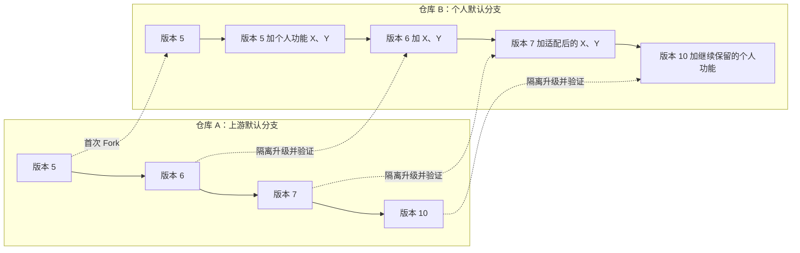
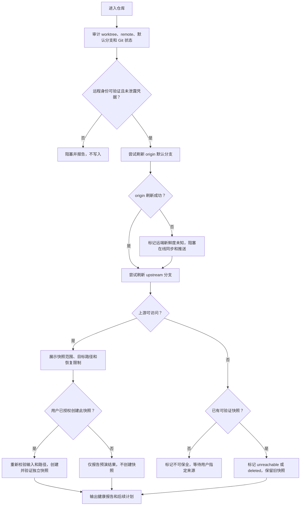
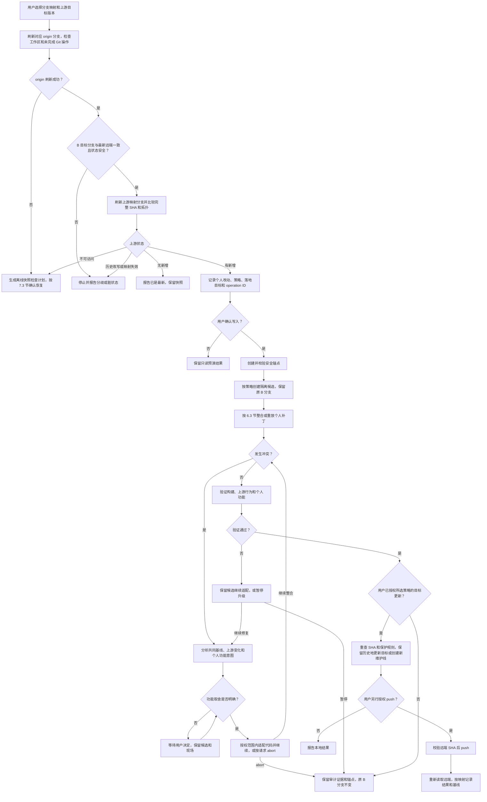
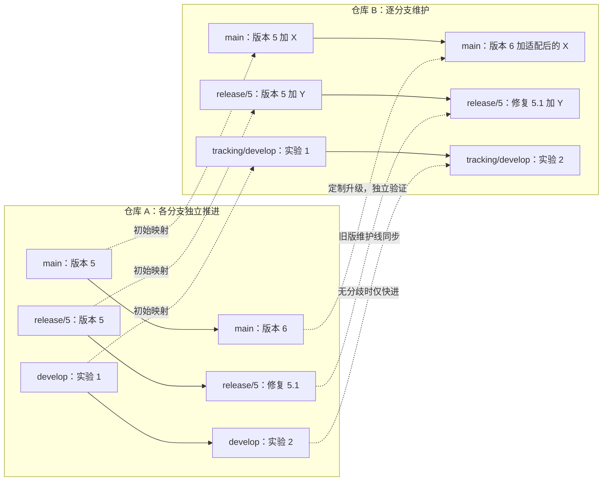

# Fork Repository Maintenance Skill PRD

日期：2026-11-05
状态：提案（仅定义产品需求，尚不创建 Skill）

## 1. 背景

Fork 外部仓库通常有两个长期目标：一是在成熟项目的基础上增加小功能、修复问题或适配个人环境；二是在上游项目被归档、删除或长期失联时，保留一份可以继续维护的代码历史。两种目标都需要保留上游来源和个人改动，但“同步上游”和“保全项目”是不同的操作。

本 Skill 暂定名为 `fork-repository-maintenance`，用于以安全、可审计、可恢复的方式维护 Fork 仓库。它同时提供：

1. **下游开发模式**：在个人维护线（默认是 `main`）上保留自己的改动，按分支映射吸收 `upstream` 的更新。
2. **项目保全模式**：保存上游代码历史和引用的独立快照，即使上游不可访问，也能继续检查、创建分支和恢复工作。

## 2. 产品目标

1. 保留个人 Fork 的 `main` 作为个人集成主线，不默认重置、覆盖、强推或替换其中的个人提交。
2. 让上游同步成为可预览、可审查、可回滚的整合过程。
3. 为每个受管分支记录上游映射、创建基线和个人改动，使多个维护线可以分别升级和继续开发。
4. 保存可独立验证的上游代码快照，明确最后成功抓取的提交、分支、Tag 和来源。
5. 在上游被删除、归档或暂时不可访问时，允许从最后快照继续维护，并清楚标记数据新鲜度和限制。
6. 让所有会改变工作树、Git 引用、共享分支或远程仓库的操作在直接入口处经过显式确认和完整校验。

## 3. 非目标

- 不替代 Git、GitHub/GitLab 的账号、权限、PR 或 CI 管理能力。
- 不默认创建远程仓库、推送、合并 PR、修改保护规则、删除分支或执行强推。
- 不假设上游分支名为 `main`；分支映射必须通过远程元数据发现或由用户明确指定。
- 不静默选择 ours/theirs 或在需求不明时自动取舍个人功能；允许在已授权的升级范围内分析冲突、提出适配方案并修改代码，结果必须经过审查和验证。
- 首版不保存 GitHub Issues、PR、Release、附件、Actions 运行记录等平台数据；首版保全范围是 Git 对象、分支、Tag 和必要的来源元数据。
- 不充当多 Fork 镜像服务、二进制制品仓库或发布渠道。

## 4. 核心概念与状态

### 4.1 远程角色

| 名称 | 角色 | 约束 |
| --- | --- | --- |
| `upstream` | 原始源仓库 | 只作为参考源，只 fetch，不向其 push。 |
| `origin` | 用户自己的 Fork | 承载个人 `main`、开发分支和协作 PR。 |
| `snapshot` | 外部保全存储 | 保存 Git 对象、引用和脱敏后的来源清单，不作为工作分支。 |

首次运行必须检查 remote 的 fetch URL、push URL、默认分支和可访问性。远程身份比较必须规范化协议、主机、路径和大小写规则；不能只比较原始字符串。报告和日志只能保存脱敏后的 URL、仓库身份摘要和 URL 指纹，绝不输出或持久化 userinfo、Token、密码、SSH 私钥或完整认证参数。若规范化后的 `origin` 与 `upstream` 指向同一仓库，或 `origin` 的 push URL 指向上游，必须阻塞并要求用户重新确认远程角色。

### 4.2 分支模型

```text
upstream/<default> ── fetch ──> 上游只读基线
       │
       │ 在同步分支中 merge / rebase / cherry-pick
       ▼
origin/main <──> 本地 main（已采纳上游 + 个人改动）
       │
       ├── feature/<topic>
       ├── fix/<topic>
       ├── chore/<topic>
       └── sync/upstream-<branch>-<sha>-<operation>

上游对象和引用 ── preserve ──> 外部 snapshot
```

- `upstream/<default>` 是最近一次成功 fetch 到本地的上游事实，不允许直接提交。
- 本地 `main` 和 `origin/main` 是不同对象：前者是工作分支，后者是最近一次 fetch 得到的远程跟踪引用。比较前必须先刷新 `origin`。
- 个人开发分支必须从选定 B 维护线当时的本地提交创建，并记录所属映射与基线；默认维护线为个人 `main`。
- 默认同步策略是从个人 `main` 创建同步分支，再将上游变更合入；是否 rebase 由仓库策略和用户明确选择决定。
- 安全锚点必须记录完整 SHA、创建时间、操作 ID 和来源；不能只依赖一个可能被移动或复用的日期分支。

这里的 `main` 是默认分支映射的示例。实际命令必须解析当前选中的上游分支和 B 目标分支；个人开发分支从所选 B 维护线创建，例如修复旧版时从 B 的 `release/5` 创建，而不是统一从 `main` 创建。

### 4.3 保全状态

每个来源应至少处于以下一种状态：

| 状态 | 含义 | 允许的后续操作 |
| --- | --- | --- |
| `active` | 最近一次来源检查和 fetch 成功 | 规划同步、创建快照、继续开发 |
| `archived` | 平台元数据或用户确认表明上游已归档 | 只读同步、从最后快照继续开发 |
| `unreachable` | 暂时无法访问，原因尚未确认 | 使用最后快照；重试检查，不得覆盖快照 |
| `deleted` | 来源确认不存在或远程永久失效 | 从最后快照恢复和继续维护 |

`unreachable` 不得直接推断为 `deleted`。没有成功获取或验证的新快照时，既有快照和审计记录必须保留。

上述状态描述来源仓库；分支另行记录 `current`、`update-available`、`conflicted`、`verification-failed`、`origin-changed` 或 `source-rewritten` 等同步状态。上游可访问和 B 的某个分支存在分歧可以同时成立，不能互相覆盖。

### 4.4 首次 Fork 的复制范围

仓库 A 是上游，仓库 B 是用户的 Fork。首次 Fork 支持 `default-only`（仅默认分支）和 `all-branches`（全部分支），未指定时展示两者差异并建议仅默认分支，执行前确定范围。

- 复制范围只决定初始分支集合，不代表之后自动同步。A 的默认分支和其他分支都可能继续推进。
- 只 Fork 默认分支，也可以在后续明确选择 A 的其他分支进行跟踪、保全或创建 B 的维护分支；不能静默扩展范围。
- Fork 完成后重新读取 A、B 实际引用和 SHA。创建期间 A 可能前进，不能假设 B 的所有分支与读取计划时完全一致。
- Fork 分支范围、后续同步选择、保全范围分别记录。只 Fork 默认分支不等于已经保全全部分支，Fork 全部分支也不等于持续备份。

### 4.5 逐分支映射与维护策略

以 `(上游仓库身份, 上游分支, B 仓库身份, B 目标分支)` 为单位建立映射。MVP 对每个 B 目标分支只允许一个上游映射；多个来源合入同一目标属于后续多上游能力。

| A 的上游分支 | B 的目标或保全对象 | 用途 | 默认整合策略 |
| --- | --- | --- | --- |
| `main` | `main` | 在最新上游基础上维护个人功能 | 在同步分支 merge，再审查合回 |
| `release/5` | `release/5` | 长期维护版本 5 的个人功能和修复 | 只整合该上游维护线 |
| `develop` | `tracking/develop` | 跟踪上游，不增加个人提交 | 仅快进；出现个人提交或上游改写时停止 |
| `experiment` | 外部快照中的对应引用 | 只保全，不持续整合到 B 工作分支 | 获取并保存引用，不合入 `main` |

`tracking/develop` 是 B 内部的分支命名示例，不是本地 `upstream/develop` 远程跟踪引用。不同映射可以采用不同策略，不能按同名分支自动绑定，也不能将所有上游分支合入 B/main。

每条映射至少记录以下信息：

- 稳定 mapping ID、A/B 仓库身份、上游分支、B 目标分支、角色（定制开发、纯跟踪或仅保全）。
- Fork 或接管时的双方完整 SHA、最后成功采纳的上游 SHA、升级前 B SHA、本次目标上游 SHA、个人改动清单。
- 整合策略、验证命令、必要的分支依赖、operation ID、快照/安全锚点和阶段状态。
- 验证结果、最终 B SHA、推送结果，以及本地完成和远端完成的区别。

最后成功采纳的上游 SHA 只有在目标分支更新并验证后才推进；部分 cherry-pick 只记录已采纳提交，不把整个上游分支标为已同步。远端完成状态必须在推送后重新读取目标远端确认，不能由本地完成状态推断。

### 4.6 从版本 5 升级到 6、7、10

版本号用于解释业务阶段，真实拓扑以完整 Git SHA 为准。Fork 时 A/main 与 B/main 都位于版本 5；随后 B 在版本 5 上增加 X、Y，A 独立发布版本 6、7、10。B 可以停留在旧版本、逐次升级或选择直接评估版本 10；是否可以跨版本升级取决于提交历史、兼容性和项目迁移要求。



图中每条升级线都包含基线检查、个人改动分析、冲突适配、功能验证和目标分支更新。版本标签不证明祖先关系；上游 force-push、分支重建或默认分支改名后，必须重新核对映射，不能按“版本更大”自动整合。

## 5. 目标用户与典型场景

| 场景 | 用户诉求 | Skill 应提供的结果 |
| --- | --- | --- |
| 首次接管 Fork | “帮我规范这个 Fork。” | 远程身份、默认分支、工作区和保全状态审计。 |
| 创建 Fork | “Fork 仓库 A，只要默认分支／全部分支。” | 创建或验证复用 B、克隆、配置远程角色，并登记实际分支集合和基线。 |
| 增加小功能 | “基于这个项目加一个功能。” | 从选定个人维护线创建开发分支，并记录映射和基线。 |
| 例行同步 | “同步上游但保留我的改动。” | 刷新双方远程、差异预览、同步分支、冲突和验证报告。 |
| 项目保全 | “这个项目可能会消失，先保存下来。” | 创建、校验并记录独立 Git 快照。 |
| 上游消失 | “上游仓库没了，继续维护我的版本。” | 从最后快照恢复可用工作树和来源状态。 |
| 选择性采纳 | “只带入上游某个修复。” | 检查重复补丁、依赖和冲突，生成可审查的 cherry-pick 计划。 |
| 健康检查 | “这个 Fork 还能安全同步吗？” | 报告远程、漂移量、未推送提交、工作区、快照新鲜度和风险。 |
| 升级定制版本 | “把基于版本 5 的个人功能迁移到版本 7。” | 锁定双方 SHA、分析功能去留、生成适配候选并验证。 |
| 管理多个维护线 | “main 跟进最新版本，release/5 继续维护旧版。” | 按分支映射分别规划，不混合各维护线的改动。 |

## 6. 功能需求（MVP）

### 6.1 仓库发现与健康审计

- 识别当前仓库、Git worktree、当前分支、HEAD、工作区状态和未跟踪文件。
- 枚举 `origin`、`upstream` 的 fetch/push URL，并输出脱敏后的规范化身份。
- 发现双方默认分支，支持 `main`、`master` 或显式映射。
- 在线健康检查应刷新每条选中映射的 `origin` 目标分支和 `upstream` 来源分支，并验证相应 remote-tracking ref 已更新；任一 fetch 失败都必须标记为该映射在线同步及推送的阻塞项，不能用陈旧引用判断远端安全。报告应保留失败原因和最后成功抓取时间。
- 离线审计和快照恢复不以 fetch 成功为前提：可以使用本地已记录的来源身份和快照清单生成报告，在校验快照、恢复路径和用户授权后恢复到新的空目录。此时远端新鲜度标记为未知，不执行在线同步、推送或覆盖现有工作树。
- 按映射计算 B 目标分支相对最新 `origin/<target>` 和 `upstream/<source>` 的 ahead/behind、共同祖先、未推送提交、未提交改动和分支差异；未配置映射时先生成建议，不猜测目标。
- 检查未完成的 merge、rebase、cherry-pick、revert、bisect、worktree 锁和浅克隆限制。
- 输出稳定的 JSON 和人类可读报告；报告包含完整 SHA、比较范围、脱敏来源、快照状态和阻塞项。

### 6.2 项目保全与快照

- 支持创建外部 Git bundle 或 bare mirror；保全模式必须使用显式引用集合抓取所声明的全部分支和 Tag，不能把只抓到一个目标分支的同步结果当作完整快照。
- 每个快照必须标记 `complete`、`partial` 或 `unknown`，列出未获取的分支、Tag、LFS 对象、子模块和平台数据；只有对象、引用和清单全部校验通过时才允许标记 `complete`。
- 每个快照必须包含：快照 ID、对象校验和、来源脱敏身份、抓取时间、各引用完整 SHA、默认分支、工具版本和创建结果。
- 快照写入使用临时目录、完整校验和原子发布；失败时不能替换已有快照。
- 快照默认存储在仓库外的 XDG 状态目录，例如 `$XDG_STATE_HOME/fork-repository-maintenance/<checkout-id>/`；用户可显式指定外部归档目录。快照目录和恢复目标必须通过真实路径、samefile、符号链接别名和父子包含关系检查，默认拒绝位于源工作树内或与源工作树重叠的路径。
- 支持列出、验证、比较和恢复快照；恢复前必须显示目标路径、来源 SHA 和可能覆盖的文件，默认不覆盖已有非空目录。
- 快照不可因一次失败的同步、远程不可访问或用户取消操作而自动删除。
- Git LFS、子模块、稀疏检出和附加 worktree 至少要报告存在及保全限制；不能把未获取的 LFS 对象或子模块仓库伪报为完整保全。

### 6.3 上游同步与整合

- 同步模式使用 `git fetch upstream --prune --tags` 或等价的目标引用集合更新上游基线，不直接改动当前工作分支；保全模式必须先获取其声明范围内的全部分支和 Tag，并将未获取范围写入快照状态。
- 同步前先刷新当前映射的 `origin` 目标分支，确认本地目标与最新远端一致；远端意外前进、工作区脏或存在未完成 Git 操作时停止该操作。
- 显示上游新增提交、个人独有提交、变更文件摘要、共同祖先和潜在冲突风险。
- 默认生成带上游短 SHA 和唯一 operation ID 的 `sync/upstream-<branch>-<sha>-<operation>` 计划；已有同 ID 分支必须先验证来源和状态，禁止静默复用未知分支。
- 写入前创建并验证安全锚点，记录 mapping ID、原 B 目标 SHA、上次采纳和本次目标上游 SHA、策略、时间和远程身份。
- 根据下表选择整合和落地方式；merge、rebase、cherry-pick 是不同策略，不统一表述为“rebase 后 merge”。
- 遇到冲突进入 7.4 节的适配流程；没有文本冲突也必须验证构建、上游关键行为、个人功能 X/Y 和项目迁移要求，不能仅凭 Git 命令成功判断升级完成。
- 用户授权更新目标后，重新检查目标 SHA 和仓库保护规则，再按策略落地；push 要有覆盖该目标和结果的明确授权，并执行预期远端 SHA 检查及普通非强制推送。MVP 不改写已发布共享分支。
- 支持仅 fetch、仅预演、整合、继续冲突、取消整合、恢复锚点和幂等重试。

| 策略 | 候选构造 | 验证后的落地方式 |
| --- | --- | --- |
| merge（定制维护线默认） | 从 B 当前目标创建同步分支，合入 A 的目标提交 | 确认旧 B SHA 仍是候选祖先，再快进目标或走保留历史的 PR 路径；目标变化时停止重新评估 |
| 仅快进（纯跟踪线默认） | 验证无个人独有提交且旧目标是上游目标的祖先 | 按仓库保护规则快进；存在分歧时停止，不 reset 镜像覆盖 |
| rebase（显式选择） | 在隔离候选中按已审查的个人补丁范围逐个重放到 A 的目标 SHA，保留原目标分支 | 未发布的个人分支可在明确授权、旧 SHA 检查后更新；已发布目标默认保留，新结果落到用户选定的新分支，不强推原目标 |
| cherry-pick（选择性采纳） | 从 B 目标创建维护分支，只采纳选中的补丁和已确认依赖 | 验证后按保留 B 历史的路径更新目标；仅记录补丁采纳，不宣称整个版本升级完成 |

rebase 会生成新的个人提交 SHA。若原 B/main 已有 X/Y，而重放候选为“版本 6 + X'/Y'”，原 B/main 通常不是候选的祖先，不能假设可以快进合回；不得用再次合并旧个人历史来冒充线性迁移。需要保留原共享主线时选择 merge；需要独立线性版本时创建新维护线，并显式调整映射，默认分支切换另需授权。存在 merge commits 的个人历史必须先确定重放范围及拓扑保留方案，不能假设一次普通 rebase 能保留全部结构。

### 6.4 个人主线与开发分支

- 创建开发分支前解析用户选择的 B 维护线，验证工作区干净、没有未完成 Git 操作，并检查对应 `origin` 目标状态。
- 按可配置的 `feature/`、`fix/`、`chore/` 前缀创建分支，记录父提交和创建 operation ID。
- 审计开发分支与选中 B 维护线的差距、是否已合并、未推送提交和最近上游基线；记录 mapping ID，不把旧版修复错误合回最新主线。
- 协助生成 PR 或本地合并计划，默认不删除本地或远程分支。
- 对需要线性历史的仓库提供 6.3 节的显式 rebase 路线和新维护线方案，不能绕过已发布目标的保护边界。

### 6.5 选择性上游采纳

- 先选择目标 B 维护线和对应 mapping ID，不把多个上游分支的候选补丁默认送到 B/main。
- 按提交 SHA、PR 编号（平台工具已配置时）或上游 Tag 定位候选变更。
- 同时检查提交祖先关系和等价补丁：使用 `git cherry`、稳定 patch-id 或等价算法识别“不同 SHA 但已应用”的变更。
- 展示候选提交的依赖范围、目标分支、变更文件和冲突风险。
- 在独立维护分支中支持 `cherry-pick --no-commit` 审查模式；用户确认后才提交或合入个人主线。

### 6.6 审计、恢复与重试

- 每次写操作记录 operation ID、时间、原始 SHA、目标 SHA、策略、脱敏远程身份、快照 ID 和结果。
- 操作记录、快照清单和锁文件写入外部状态目录；不把凭据或未脱敏 URL 写入仓库。
- 支持查看最近操作、比较前后差异、从指定快照或锚点恢复，以及导出可放入 PR 描述的报告。
- 相同 operation ID 重试必须先验证 mapping ID、已有分支、锚点、快照和该阶段的前置条件；在线整合或推送重试还必须刷新并验证当前远程 SHA，离线恢复重试只验证本地快照和恢复目标。输入未变时继续原操作，不创建重复提交或重复快照；升级失败不能推进最后成功采纳的上游基线。
- 远端分支意外前进、来源身份改变、快照校验失败或恢复前置条件不满足时停止，不默认 force-push、reset 或删除数据。

### 6.7 多分支同步与依赖（MVP）

- 全部分支 Fork 后先盘点各分支，将其明确分类为定制开发、纯跟踪、仅保全或未管理；复制成功不会自动授权逐分支整合。
- 一次同步必须选定 mapping ID 集合，分别生成 SHA、差异、策略、验证命令和操作 ID；状态、日志、锚点和进度按映射隔离。
- 相互独立的分支可分开处理。一个分支冲突或失败不影响其他已验证映射；只有隔离的工作目录或 worktree 才能继续处理其他映射，不能在冲突工作树中切换操作。
- 有依赖的维护线先生成有向依赖图，按依赖顺序处理并重新验证交互；依赖失败时阻塞其下游。循环依赖或未确认的跨分支改动先报告，不自动猜测顺序。
- 上游新增分支只报告为待选择；上游删除分支、强制改写或默认分支改名时保留 B 分支、快照和旧映射证据，标记对应映射待处理，不自动删除、重置或改绑。
- 每次批处理报告各映射的成功、冲突、失败、跳过和阻塞状态，不把部分成功报告为整个仓库升级完成。共享目录中的配置、子模块或生成文件受多条维护线影响时，需要加入交互验证。

## 7. 关键工作流

### 7.1 首次接管与保全



首次运行只做审计和计划。补齐缺失 remote、改变跟踪配置、创建快照或创建分支都必须分别获得用户确认。

### 7.2 常规同步与恢复



该图应用于每条选中的分支映射。用户取消或中止后保留操作记录和可恢复证据，不把中止结果传入验证或目标更新路径；候选状态必须区分“正在整合”“整合完成但验证失败”和“已中止”。

### 7.3 上游消失或归档

1. 使用本地来源记录检查仓库身份，并在网络可用时尝试重新验证远程访问结果；网络不可用或 fetch 失败不能阻塞本地快照验证和离线恢复。一次网络失败只能标记 `unreachable`，远端新鲜度保持未知。
2. 只有在平台元数据、持续失败和用户确认共同支持时，才标记 `deleted` 或 `archived`。
3. 选择最近一个完整且校验通过的快照，展示其来源 SHA、快照时间和缺失能力。
4. 展示快照 ID、来源 SHA、目标路径和操作影响；用户授权后重新检查快照完整性和路径安全，再恢复到新的空目录。没有可验证快照或用户未授权时，只报告原因，不创建恢复目录或修改既有工作树。
5. 恢复后的仓库保留 `origin` 的个人维护角色和原有来源记录，不自动联网或推送；远程配置须通过脱敏和身份校验，不携带快照中的认证信息。恢复网络后必须刷新并验证远程状态，才能进入在线整合或推送流程；不把失效的 `upstream` 自动改写成其他 URL。

### 7.4 冲突与失败恢复

1. 在当前工作树存在未完成 merge、rebase 或 cherry-pick 时，只允许处理所属 operation 的继续、检查或 abort；其他独立映射必须使用隔离工作树，不能混用现场。
2. 按共同基线、上游目标和个人改动三方分析冲突，报告文件、相关提交、功能意图和二进制/LFS/子模块限制。不能统一采用 ours/theirs；rebase 的两侧语义也不能按仓库名字猜测。
3. 对每个个人功能提出“迁移到新接口”“由上游等价能力替代”“继续保留旧行为”或“放弃该功能”等方案。例如版本 6 重构登录模块后，必须决定版本 5 的登录增强 X 应迁移到哪个入口。需求和证据不足时由用户决定，不静默删减功能。
4. 在已授权的升级范围内可由 Skill 适配代码；涉及功能取舍、超出授权范围或变更策略时先取得用户决定。每次继续前核对 operation ID、mapping ID、源/目标 SHA 和当前操作状态，再执行 staging 或提交。
5. rebase 按个人提交逐个重放，解决当前冲突后还可能在下一提交再次冲突；只有整合全部结束后才进入最终验证。上游已有等价补丁时，应展示依据并记录替代关系，不能盲目 skip 丢弃功能。
6. 文本冲突解决和功能适配完成分别记录。即使 Git 未报告冲突，若 API、默认配置或运行行为变化导致测试失败，也进入适配流程；缺少可执行验证时报告未验证范围，不能声称功能兼容已通过。
7. 验证失败时保留候选、锚点、快照和日志，原 B 目标和成功基线保持不变。仍在整合中的候选可执行对应 abort；已完成整合但测试失败时不存在可依赖的 merge/rebase abort，改为继续修复或放弃候选，不能对原目标 reset。
8. 恢复失败时保留临时目录和已有快照，并报告恢复路径；不得静默清理唯一副本。

### 7.5 从一句 Fork 请求开始

1. 解析仓库 A、用户账号、仓库 B 名称和本地目录；检查是否已经存在具有正确来源关系的 B。名称相同不能视为可复用的证据。
2. 确定 `default-only` 或 `all-branches`，展示实际会创建/复用的仓库、初始分支范围和后续用途。明确的创建请求作为该范围内的授权；缺少范围或身份时先补足信息，不自动推送额外分支。
3. 有授权且平台工具可用时创建或复用 Fork，再克隆到确认的本地位置。平台工具不可用时报告限制，允许用户提供已创建的 B 后继续；重试前重新检查 B 的来源和已完成阶段，不能重复创建或覆盖目录。
4. 配置并验证 `origin` 指向 B、`upstream` 指向 A，读取双方实际分支 SHA。只复制默认分支时只建立对应初始映射；复制全部分支时先生成逐分支分类和映射建议，未选中分支保持未管理。
5. 记录 Fork 范围、接管基线和映射；提出独立保全计划，按 7.1 节的快照授权边界执行。复制分支、建立持续同步关系和生成完整备份分别报告，不互相代替。
6. 输出 B 地址、本地目录、每条选中映射的基线、未管理分支、快照状态和可执行的下一步；不自动将所有分支发布或升级。

### 7.6 多分支发展路线



图中 X、Y 在 Fork 后分别加入对应维护线；上游推进不直接更新 B。仅默认分支 Fork 时，初始只存在 main 的映射，其他维护线必须由后续选择创建。B/main 升级到版本 6，不会自动升级 B/release/5；某条线发生冲突只暂停该线及其已声明依赖，不合并其他上游分支来“补齐版本”。

## 8. 安全、确认与直接入口

- **默认只读**：审计、刷新远程引用、差异分析和计划生成不写工作树；fetch 是唯一默认允许改变本地 Git 引用的操作。
- **逐项确认**：创建快照、创建/切换分支、merge、rebase、cherry-pick、commit、tag、push、修改 remote、恢复快照和删除临时数据前，必须说明目标、影响、源/目标 SHA 和恢复路径，等待明确确认。
- **直接入口自带门禁**：任何脚本直接调用都必须执行同样的状态、身份、路径和输入校验；不能假设调用者已经读过 `SKILL.md`。写入入口要求来自预演阶段的 operation token 或等价显式确认参数。
- **校验先于 mutation**：创建目录、锁、临时快照、分支、staging 文件或日志记录都算 mutation；所有必要输入必须在首次 mutation 前完成校验。
- **禁止默认危险操作**：不执行 `push --force`、`reset --hard`、删除分支、清理未跟踪文件、自动 stash、覆盖 remote URL 或删除唯一快照。
- **凭据边界**：只在 Git 自身需要时使用凭据；不读取、打印、持久化或传递 Token、密码、SSH 私钥和未脱敏 URL。
- **远程并发保护**：push 前重新获取目标远程 SHA，并使用 lease 或等价的 expected-old-value 检查；远端已前进时停止。
- **外部状态**：运行时日志、锁、快照清单和恢复证据默认位于外部 XDG 状态目录；仓库内仅保存用户明确要求纳入版本控制的配置。所有状态、快照和恢复目标都必须拒绝同源路径、符号链接别名、大小写别名和互相包含的危险布局。

## 9. 建议的 Skill 形态

实现时采用“便携流程说明 + 确定性脚本 + 按需参考”的结构，避免只依赖自然语言命令。目录必须遵循仓库的 Skill 结构：

```text
skills/fork-repository-maintenance/
├── SKILL.md
├── README.md
├── README.zh-CN.md
├── CHANGELOG.md
├── agent-builds/
│   └── codex/
│       └── agents/openai.yaml
├── scripts/
│   └── fork_maintenance.py
├── references/
│   ├── branch-model.md
│   ├── preservation-and-recovery.md
│   ├── conflict-recovery.md
│   └── special-git-features.md
└── tests/
    └── fixtures/
```

脚本应支持 `--json`、`--dry-run`、稳定的非零错误码和显式 operation token。只读审计、计划、快照创建、同步、恢复和日志查询应有清晰的子命令；每个会写入状态的子命令都必须独立执行入口校验。运行时状态和快照默认不进入仓库，也不被 `sync-skills` 当作 Skill 副本同步。

## 10. 与现有能力的边界

- `source-version-train` 负责需求分支、版本集成分支、发布候选、打包、发布和 Tag；本 Skill 不接管发布列车。
- `sync-skills` 负责 Skill 文件副本、来源、构建产物、安装快照和回滚；本 Skill 不把 Git 仓库同步状态伪装成 Skill 副本关系。
- GitHub 原生 Fork Sync、`gh repo sync` 和第三方 Actions 可作为已配置平台能力，但不能替代本 Skill 的本地审计、凭据脱敏、快照校验和恢复门禁。
- 若用户只请求普通 Git 分支操作、版本发布或 Skill 副本同步，应路由到对应能力，不触发本 Skill。

## 11. 成功指标与验收标准

### 11.1 成功指标

- 用户可以在保留原 B 维护线可恢复历史的前提下，从上游版本 5 升级到 6、7 或明确选择的后续版本，并验证个人功能的保留、迁移或替代结果。
- 用户可以在上游仍可访问时创建可验证的独立快照。
- 上游归档、删除或不可访问后，用户可以从最后完整快照恢复并继续创建开发分支。
- 所有影响共享分支、远程仓库或唯一快照的操作在执行前都被阻止或要求明确确认。
- 重试不会创建重复同步分支、重复快照、重复 cherry-pick 或重复远程写入。
- 全部分支 Fork 后可以按映射分别升级，未选择的分支及原成功基线不受其他映射失败影响；报告清楚区分每条分支的本地与远端完成状态。

### 11.2 最小验收场景

1. 上游新增提交、个人 `main` 已合入自有 feature：预演正确识别双方差异，整合后个人功能仍在历史和结果中可见。
2. `origin/main` 在本地引用之后前进：刷新后 Skill 停止同步，不覆盖本地或远端。
3. 工作区存在未提交改动或未完成 Git 操作：Skill 不切分支、不合并、不自动 stash。
4. 上游整合产生文本冲突：Skill 报告冲突，支持继续或 abort，个人 `main` 不变。
5. 上游提交已以不同 SHA 应用：Skill 通过 patch-id 或等价检查识别重复，不重复采纳。
6. 上游可访问：创建 bundle 或 mirror，校验对象、引用和清单，并能恢复到新的空目录。
7. 上游返回不可访问：状态先标记 `unreachable`；已有快照保持不变。
8. 上游确认删除或归档：从最后快照恢复，报告快照时间、来源 SHA 和未保全的平台数据。
9. remote URL 含认证信息：报告和日志中只出现脱敏身份，原始凭据不落盘。
10. 同一 operation 重试：复用已验证状态，不创建重复分支、快照或提交。
11. 仓库包含 LFS、submodule、稀疏检出或附加 worktree：显式报告限制，不伪报完整保全。
12. 只抓取一个上游分支或遗漏 Tag：快照标记为 `partial` 或 `unknown`，不能报告为完整保全。
13. `origin` 和 `upstream` 的规范化身份相同，或 push URL 指向上游：操作在首次 mutation 前阻塞。
14. 快照目录位于源工作树内、通过符号链接别名重叠或与恢复目标互相包含：操作被拒绝且已有快照不变。
15. `origin` 或 `upstream` fetch 失败：在线同步和推送被阻塞，离线审计仍输出最后抓取时间与未知新鲜度；存在完整、校验通过的快照时，经用户授权可恢复到新的空目录。
16. 离线恢复没有可验证快照、校验失败或用户未授权：不创建恢复目录，不修改既有工作树或快照；重试同一恢复操作不要求远程可访问。
17. 首次保全的预演未获用户授权：不创建快照、临时目录或操作锁；授权后重新校验输入和目标路径，再创建快照。流程图与直接脚本入口均遵循此边界。
18. 仅默认分支 Fork：登记实际复制的默认分支 SHA，不自动创建其他 B 分支；后续选择另一上游分支时显式新增映射，并保留初始 Fork 范围记录。
19. 全部分支 Fork：盘点实际复制集合，逐分支分类和选择映射；A/main 的更新不能自动合入 B/release/5 或未管理分支。
20. B 基于版本 5 已有 X/Y，A 推进到 6、7、10：每次计划锁定完整 SHA，允许留在旧版或评估跨版本迁移，不能按版本号推断兼容和祖先关系。
21. 上游重构导致文本冲突：分析三方变化，将 X 迁移到新接口或按用户决定采用替代方案；多次 rebase 冲突逐个处理，最终测试通过前不更新原 B 目标。
22. 没有文本冲突但个人功能行为失效：验证失败进入适配流程，不能报告升级成功；候选已完成整合时不调用无效的 abort 或重置原目标。
23. 对已发布的 B/main 选择 rebase：记录重写后的补丁 SHA，默认生成新维护线并保留旧 main；不能假设原 main 可快进到候选，也不强推旧目标。
24. 独立映射一条冲突、另一条通过：隔离工作树中可分别处理；有依赖的映射按顺序验证，依赖失败则阻塞下游，循环依赖先报告。
25. 上游新增、删除、重写分支或改变默认分支：标记映射状态并保留 B 分支、快照和旧基线，不自动删除或按同名改绑。
26. 部分 cherry-pick、验证失败或推送失败：分别记录补丁采纳、本地结果和远端结果，不能把整个上游分支或仓库标记为已同步；重试只继续对应映射和阶段。
27. Fork 创建期间 A 分支前进，或创建流程中断后重试：重新读取 B 实际 SHA 并核验来源，不重复建仓或覆盖已有目录，不伪报所有分支与计划时刻一致。

## 12. 待决策项

- 快照默认采用 Git bundle、bare mirror，还是两者按仓库规模分层；建议 MVP 先支持 bundle，并保留 mirror 扩展点。
- 是否把 GitHub 归档/删除状态作为平台适配器；建议 MVP 以 Git 访问结果为主，平台 API 作为可选增强。
- 审计状态和快照是否支持用户指定外部归档根目录；建议默认 XDG 外部状态，允许显式导出。
- 配置格式应支持逐分支策略、依赖和验证命令；定制维护线默认 merge、纯跟踪线默认仅快进，rebase 的落地边界以 6.3 节为准。
- 是否将自动定时保全纳入首版；建议先提供手动、可验证的 `preserve`，定时任务作为后续增强。
- 分支命名、测试命令、保护规则和快照保留期限采用仓库局部配置、用户全局配置，还是分层合并；建议仓库局部优先、用户全局兜底。

## 13. 下一步

在用户确认本 PRD 后，先确定快照格式、外部状态目录、逐分支映射与阶段状态格式、配置优先级和脚本子命令；再初始化符合仓库结构的 Skill，实现首次 Fork/接管、只读审计和 `preserve` MVP。随后在临时裸仓库拓扑上验证版本 5 到 6/7/10 的定制迁移、多分支隔离与依赖、冲突和无文本冲突的功能回归、删除/归档恢复、重复补丁、凭据脱敏和幂等重试。

## 14. 设计依据

- [GitHub：Fork a repository](https://docs.github.com/en/pull-requests/how-tos/work-with-forks/fork-a-repo)：只复制默认分支与复制全部分支的初始范围。
- [Git：git-rebase](https://git-scm.com/docs/git-rebase)：提交重放、冲突继续/中止，以及历史改写的语义。
- [Git：git-merge](https://git-scm.com/docs/git-merge)：快进、合并提交和冲突处理的语义。

以上依据于 2026-11-05 核对；平台接口和权限要求在实施时需按实际工具版本重新确认。
