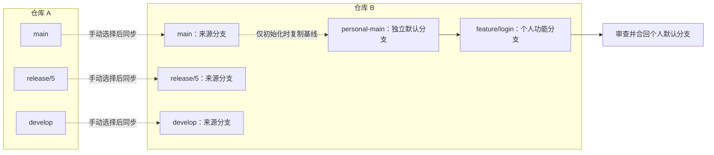
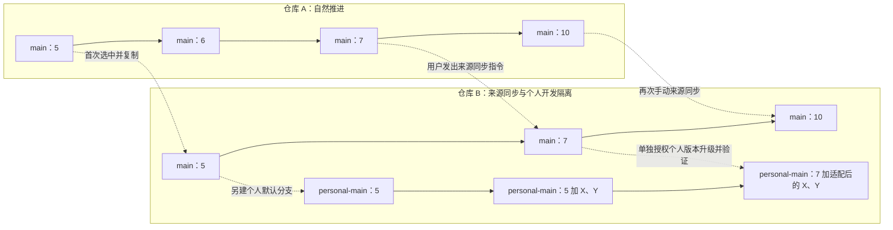
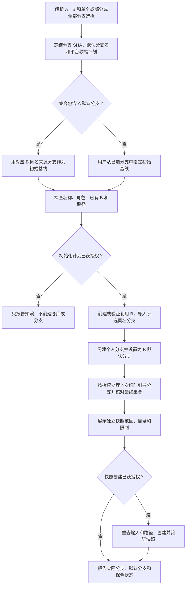
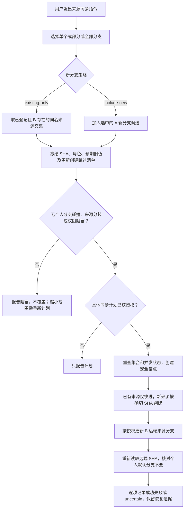

# Fork Repository Maintenance Skill PRD

日期：2026-11-05
状态：已实现 0.0.1 实验版本；真实 GitHub 写入验证待补充。

配套文档：[技术设计](2026-11-05-fork-repository-maintenance-technical-design.md)，包含拟议接口、状态模型、安全边界与实施测试矩阵。

现有接口见 [Skill 使用说明](../../../skills/fork-repository-maintenance/README.zh-CN.md)和[运行契约](../../../skills/fork-repository-maintenance/references/runtime-contract.md)；测试范围和限制见[实施覆盖账本](2026-11-05-fork-repository-maintenance-implementation-review.md)。以下产品目标保留，首版限制以运行契约明确列出的边界为准。

## 1. 背景

Fork 外部仓库通常有两个长期目标：在成熟项目上增加个人功能，以及在上游项目归档、删除或失联后保留可继续维护的代码。为避免上游分支推进与个人开发混在一起，本 Skill 将 B 仓库中的分支分为“与 A 同名的来源分支”和“独立的个人默认分支”。

仓库 A 为原仓库（`upstream`），仓库 B 为 Fork 仓库（`origin`）。Skill 支持选择 A 的单个、部分或全部分支建立 B 的同名分支；另外从选定基线新建一个可配置名称的 B 默认分支，供个人开发。首版不自动同步，只有用户发出同步指令后才更新选中的来源分支。来源同步和个人功能升级是两个独立操作。

## 2. 产品目标

1. 支持选择单个分支、指定分支集合或全部分支作为首次 Fork 的业务范围。
2. A 与 B 的来源分支一一同名对应；B 默认分支必须另建，不属于来源映射。
3. 通过明确的同步指令，按单个、部分、全部分支更新 B，并区分仅已有映射和包含 A 新分支两种范围。
4. 来源同步不修改 B 的个人默认分支、功能分支或未选择的来源分支。
5. 用户单独要求个人版本升级时，在隔离候选中整合来源更新、适配冲突并验证个人功能。
6. 保存可独立验证的代码历史快照，支持上游不可访问后的离线恢复。
7. 为每阶段记录来源 SHA、目标 SHA、授权范围和可恢复证据，使失败与重试不会覆盖个人工作。

## 3. 非目标

- 首版不执行定时、Webhook、后台轮询等自动同步，不自动将来源分支的更新合入个人默认分支。
- 不把 GitHub 原生“仅默认分支／全部分支”描述为任意分支选择 API。Skill 的选定分支结果通过多阶段流程实现。
- 不自动将 B 的个人修改反向推送给 A，不自动 force-push、重置来源分支或删除 A 已删除的 B 对应分支。
- 不静默取舍冲突功能；允许在已授权升级范围内分析和适配代码，功能取舍不明时由用户决定。
- 首版不保存 Issues、PR、Release 附件、Actions 记录等平台数据；不充当多上游、多 Fork 镜像服务或发布渠道。

## 4. 仓库、分支与范围模型

### 4.1 远程角色与来源身份

| 名称 | 角色 | 约束 |
| --- | --- | --- |
| `upstream` | 仓库 A | 只读取来源，不向 A 推送。 |
| `origin` | 仓库 B | 保存同名来源分支、独立个人默认分支和个人功能分支。 |
| `snapshot` | 外部快照存储 | 保存 Git 对象、引用、角色和脱敏来源清单，不是工作分支。 |

首次运行检查 fetch URL、push URL、默认分支和可访问性，按托管平台规则规范化仓库身份。A/B 实为同一仓库，或 B 的 push URL 指向 A 时阻塞。报告、日志、指纹和快照配置都只能使用脱敏身份，不能保存或输出 URL userinfo、Token、密码、认证查询参数、SSH 私钥或原始凭据；Git 错误输出也须脱敏。

### 4.2 B 的分支角色与默认分支规则

| B 分支角色 | 示例 | 与 A 的关系 | 来源同步是否可更新 |
| --- | --- | --- | --- |
| 来源分支 | `main`、`release/5`、`develop` | 与已选择的 A 分支严格同名、分别登记 | 是，限本次选择且通过校验的分支 |
| 个人默认分支 | `personal-main`（名称可配置） | 只在创建时从一个来源分支复制基线，不建立持续同步映射 | 否，必须排除 |
| 个人功能或维护分支 | `feature/login`、`personal/release-5` | 从个人默认分支或明确选择的基线创建 | 否，必须排除 |

B 默认分支必须新建，不能直接使用任何已 Fork 的同名来源分支：

1. 若选中集合包含 A 当时的默认分支，则从 B 中该同名来源分支的已验证 SHA 创建个人默认分支。
2. 若集合不包含 A 的默认分支，用户必须从已选分支中指定默认分支的基线；未指定前可预演，但不得开始创建远端 Fork。
3. 用户确定个人默认分支名称；名称不能与已选来源分支相同，也不能与已有个人/来源分支发生引用命名冲突。
4. “复制基线”是在 B 内创建一个指向相同提交的新分支，保留历史，不是创建另一个仓库，也不产生持续更新关系。
5. 创建并校验该分支后，才将平台上的 B 默认分支设置为它；本地 remote HEAD 和跟踪设置随后核对。失败时报告未完成的初始化阶段，不宣称 Fork 初始化成功。
6. 已接管的 B 不满足此结构时先生成迁移计划，不自动更名、删除旧分支或改动默认分支。



个人开发提交应落在个人分支。若 B 来源分支出现个人独有提交，来源同步必须停止并建议先保留到个人维护线，不能 merge、rebase 或 reset 掩盖来源分支已被修改的事实。

### 4.3 首次 Fork 与平台实现范围

业务选择支持 `single`（一个确切分支名）、`selected`（显式分支集合）和 `all`（计划时 A 的全部可见分支）。“只选默认分支”是 `single` 的常见用法。所有集合展开为确切的 `refs/heads/*`、完整 SHA 和计划 ID，不支持用一个未冻结的“全部”在执行时悄悄扩大范围。

GitHub 原生创建 Fork 仅提供默认分支／全部分支选项；Skill 对任意选定分支的支持是结果能力，实施方式为：

1. 先规划业务分支集合、个人默认分支名和基线、平台原生引导方式及必要收尾动作，再取得覆盖这些动作的授权。
2. 原生创建或验证复用 B，按确切 SHA 导入选中分支并保持与 A 同名，随后按 4.2 节另建并设置 B 默认分支。
3. 若原生流程产生了业务集合外的临时引导分支，只能在新建 B 中、确认由本次操作创建且 SHA 未被他人推进、默认分支已切换、保护规则允许且计划明确授权删除时清理。不能清理复用仓库的既有分支。
4. 无法安全达到精确集合时保留现场，报告额外分支及原因，状态为初始化未完成；不得宣称“只 Fork 了选中分支”。
5. 创建期间 A 可能推进。分支内容以计划中的完整 SHA 为基线；变化时报告漂移，重新确认计划，不直接改用新 SHA。执行后核对 B 引用、默认分支设置和实际集合。

Tag、保全范围和后续同步范围另行选择；“全部分支”不自动包含全部 Tag、平台附件或未来新增分支。这里的精确分支集合指 B 可见分支引用，不承诺 Fork 网络中底层 Git 对象只包含这些分支。

### 4.4 手动同步：选择集合与新分支策略

每次 `sync` 都需要两个维度，默认不自动运行：

| 维度 | 选择 | 含义 |
| --- | --- | --- |
| 分支集合 | `single` | 指定 A 的一个确切分支名 |
| 分支集合 | `selected` | 指定 A 的多个确切分支名 |
| 分支集合 | `all` | 展开计划时 A 可见的全部候选分支 |
| 新分支策略 | `existing-only`（默认） | 仅更新已登记且 B 中仍存在的同名来源分支，不创建缺失分支 |
| 新分支策略 | `include-new` | 更新已有来源映射，并按计划导入选中但尚未存在的 A 分支到 B 同名分支 |

集合规则：`existing-only` 取“选择的 A 分支 ∩ B 已登记且仍存在的同名来源分支”；缺失项报告为跳过。`include-new` 对已存在但未登记的 B 同名分支先报告身份/角色冲突，不能仅凭同名接管或覆盖。新分支导入后核对 SHA 并登记来源映射。

例如：A 有 `main`、`release/5`、新建的 `develop`，B 有已登记的 `main`、`release/5` 及个人默认分支 `personal-main`：

| 指令示例（自然语言） | 预期更新集合 | 明确不变的分支 |
| --- | --- | --- |
| “同步 main” | B/main | B/release/5、personal-main |
| “同步 main 和 release/5” | 两个已登记来源分支 | personal-main |
| “同步全部，只更新 B 已有对应分支” | B/main、B/release/5；develop 跳过 | personal-main |
| “同步全部，并引入 A 的新分支” | 更新两个来源分支，新增 B/develop | personal-main |
| “只引入 A 的 develop” | 若名称可用，新增 B/develop | B 的其他全部分支 |

同步中的“全部”永远不代表 B 的全部分支。个人默认分支和个人功能分支必须从执行集合排除；若 A 未来新增与 B 个人分支同名的分支，或存在 `foo` 与 `foo/bar` 等 Git 引用命名冲突，报告阻塞项，不覆盖、不自动更名。A 删除来源分支后，保留 B 对应分支和最后基线并标记 `source-missing`，不传播删除。

### 4.5 映射、阶段与来源状态

映射键包含 A/B 规范化身份和同一个分支名，MVP 不支持异名来源映射。个人默认分支只有独立 `personal-default` 角色和初始基线记录，不占用来源映射。

每条映射记录 mapping ID、分支名、首次 SHA、最后成功同步 SHA、计划中的 A SHA、预期 B SHA、operation ID、锚点/快照、阶段状态和结果。记录 B 默认分支的配置名称、初始化来源分支和 SHA、平台设置结果；后续同步不能重算或自动切换它。

来源状态为 `active`、`archived`、`unreachable` 或 `deleted`；分支同步状态另记 `current`、`update-available`、`origin-changed`、`source-rewritten`、`source-missing`、`role-conflict` 或 `failed`。一次访问失败不能判定仓库已删除；仓库状态和分支状态可以并存。

只有重新读取 B 远端并确认分支等于计划 A SHA 后，才能推进该分支的远端成功基线；仅 fetch、仅预演、本地完成、跳过和失败均不能伪报远端同步成功。整个批次报告逐分支结果，不把部分成功标记为全部完成。

### 4.6 版本 5 到 6、7、10 的两条路线

Fork 时 A/main 位于版本 5，B/main 保存相同基线，再从 B/main 创建 B/personal-main 并开发 X、Y。A 之后推进到 6、7、10：



图中 B/main 同步到版本 7、10 时，B/personal-main 仍可保持“5 + X、Y”；只有用户另外请求整合并验证后才推进个人版本。用户可停留旧版、逐次升级或直接评估后续版本；版本标签不证明提交祖先关系，必须使用完整 SHA 核对。来源同步到 7 不要求先同步到 6，只要快进关系和计划条件成立；个人功能的跨版本迁移则要评估项目兼容要求。

## 5. 用户指令与预期结果

| 场景 | 用户诉求 | Skill 应提供的结果 |
| --- | --- | --- |
| 选定分支 Fork | “Fork A 的 release/5 和 develop，个人默认分支叫 my-main。” | 明确默认基线，创建同名来源分支和另建 my-main，验证初始化结果。 |
| 全部分支 Fork | “Fork A 全部分支，个人默认分支叫 personal-main。” | 从 A 默认分支的同名副本另建 personal-main，其他来源分支保持同名。 |
| 单分支同步 | “同步 A/main 到 B/main。” | 只规划和更新该来源分支，不修改个人默认分支。 |
| 已有分支同步 | “同步全部，但只同步 B 已有对应分支。” | 更新已登记的来源交集，报告 A 新分支为跳过。 |
| 包含新分支同步 | “同步全部，并包含 A 新建的分支。” | 更新已登记来源分支并按授权创建新的同名来源分支。 |
| 个人开发 | “在我的版本上加功能。” | 从 B 独立个人默认分支创建功能分支，审查后合回个人默认分支。 |
| 个人版本升级 | “把我的版本从 5 升级到 7，并保留 X。” | 从 B 已同步来源的确切 SHA 创建整合候选，适配并验证 X，另行更新个人目标。 |
| 项目保全/恢复 | “保存这个项目／从快照恢复。” | 按独立范围生成快照或在离线校验后恢复，报告完整性与限制。 |

## 6. 功能需求（MVP）

### 6.1 仓库发现与预演

- 识别当前仓库、worktree、分支、HEAD、未提交和未跟踪文件，以及未完成 Git 操作。
- 枚举并验证 A/B 身份、来源映射和 B 独立默认分支配置，刷新选中远端引用；fetch 只更新本地对象/跟踪引用，不等于已同步到 B。
- 每次计划展开具体分支和完整 SHA，包含单个/部分/全部范围、新分支策略、预期远端旧值、保护规则、角色冲突、跳过项和确认后的执行集合。
- 在线获取失败只阻塞相关在线操作，不阻塞离线报告和已验证快照的恢复；报告最后成功抓取时间与未知新鲜度。
- 输出稳定 JSON 和人类可读报告。未完成初始化或默认分支配置缺失时，报告阻塞项，不猜测目标。

### 6.2 来源分支手动同步

- `sync` 默认 `existing-only`，要求选定分支范围；“全部”的实际集合在计划阶段冻结，执行时新出现的分支留给下次计划。
- 对已有来源分支，先要求 B 当前 SHA 等于登记的预期成功值，再验证旧 B SHA 是计划 A SHA 的祖先；通过后才能快进到计划 SHA，不制造 merge commit。相等时为无变更；B 意外推进、个人独有提交或 A 改写历史时停止相关映射。
- 对 `include-new` 的新分支，必须确认 B 同名引用不存在、名称不是个人默认分支/个人分支且无引用命名冲突，再从计划 A SHA 创建；更新和创建都要遵守仓库保护规则。
- 选中项的角色、输入、路径和计划 SHA 必须在首次持久化前完整校验。先报告静态阻塞项；用户可明确移除阻塞项后重新形成计划，不在运行中悄悄扩大、缩小或改绑集合。
- B 写入前验证并保留安全锚点，采用预期旧 SHA 的并发检查，并独立要求祖先关系；不能把 lease 当作允许非快进覆盖。执行集合外的 B 分支和个人默认分支引用、工作树、配置保持不变。
- 来源同步是“更新 B 远端”的完整业务动作。用户对具体计划的同步授权可覆盖相应创建和推送，无须重复确认同一动作；仅 fetch、仅预演或仅本地准备的结果必须标记未完成远端同步。
- 推送后重新读取 B 远端验证 SHA 再记录成功；超时或返回结果不明时标记 uncertain，先核对远端再重试。多个独立映射可能部分完成，报告逐项结果，不自动回滚已确认成功的远端分支。
- 首版不同步删除，不覆盖来源分歧，不重命名来源分支，不修改 B 默认分支设置，不自动更新个人代码。

### 6.3 独立个人默认分支和个人开发

- 初始化时按 4.2 节选择基线和名称，新建个人默认分支后设置 B 默认分支；即使包含 A/main，也必须另建个人分支，不能直接把 B/main 当作个人默认分支。
- 个人功能分支从个人默认分支创建，记录父 SHA、开发意图和操作 ID；完成后按 B 保护规则审查并合回个人默认分支。
- 可显式从某个来源基线另建个人维护线，角色属于个人分支；它不能成为同名来源同步目标，也不能修改已有来源映射。
- 用户修改 B 默认分支名或基线属于独立配置迁移；来源同步不触发该迁移。默认分支与新上游分支重名时阻塞新分支导入，保留个人分支。

### 6.4 个人版本升级与选择性采纳

个人版本升级通过单独的 `integrate` 意图执行，不属于 `sync`。输入包含已保存在 B 来源分支的完整目标 SHA、个人目标旧 SHA、需保留的功能清单、策略和验证命令。若 B 来源尚未取得所需版本，先提示手动来源同步，不隐式连带升级个人分支。

| 策略 | 候选构造 | 验证后的落地方式 |
| --- | --- | --- |
| merge（共享个人维护线默认） | 从个人目标创建隔离候选，合入 B 来源的指定 SHA | 确认旧个人 SHA 仍在候选历史中，按保护规则快进或通过保留历史的 PR 更新个人目标 |
| rebase（显式选择） | 在隔离候选中按审查过的个人补丁范围重放到来源 SHA | 未发布个人分支可在授权和旧 SHA 检查后更新；已发布目标保留，新结果落到用户选定的另一条个人维护线 |
| cherry-pick | 从个人目标创建候选，采纳所选补丁与已确认依赖 | 通过祖先关系和 patch-id 等价检查避免重复采纳，验证后更新个人目标，只记录补丁采纳而非整版升级 |

rebase 重放通常产生新 SHA，原个人目标不一定是候选祖先，不能假设“rebase 后直接快进 merge 回原分支”。共享目标默认保留历史，不强推；选择新维护线也不自动切换 B 默认分支。存在 merge commits 时先确认重放范围和拓扑方案。

冲突解决与行为兼容分别验证；即使没有文本冲突，也必须检查构建、上游关键行为、个人 X/Y、配置和 API 迁移。验证失败保留候选和锚点，个人目标与成功基线不动；缺少验证能力时明确未验证范围，不宣称升级兼容已通过。

### 6.5 项目保全与离线恢复

- 支持外部 Git bundle 或 bare mirror；保存所声明范围的分支、Tag 和可达对象，范围与 Fork/sync 集合独立。必须报告哪些范围未保全。
- 每份快照记录 snapshot ID、来源脱敏身份、时间、各引用完整 SHA、A/B 来源分支与个人默认分支角色、对象校验和、完整性状态和工具版本。
- 区分 `complete`、`partial`、`unknown`；完整性针对声明的 Git 范围，并列出平台数据、LFS 和子模块等排除项。未获取的必要对象不能伪报完整；用于独立恢复的 bundle 不得依赖未保留的前置对象。
- 临时写入、完整校验后原子发布新快照，失败不替换旧快照，不因上游失联或同步失败删除唯一可恢复副本。
- 日志、锁和快照默认位于仓库外的 XDG state 根目录，允许明确指定外部归档位置；检查真实路径、samefile、符号链接/大小写别名、父子包含及所有权，不能写入或包含受保护源工作树。
- 恢复不要求 A/B 可访问；本地校验快照和目标路径后，在授权范围内恢复到新的空目录，不覆盖既有工作树，不自动联网或推送。记录个人默认分支角色，远端默认设置待联网后核验，不把离线恢复当作远端设置完成。
- LFS、子模块、浅克隆、稀疏检出和附加 worktree 必须报告存在及限制。来源不可访问时保留最后快照和来源记录，不自动换 URL。

### 6.6 审计、并发和重试

- 每次写操作记录 operation ID、计划摘要、角色、选中集合、策略、原/目标 SHA、安全锚点、阶段和结果；凭据不落盘。
- 首次 Fork、来源同步、个人整合和恢复使用独立阶段。相同 operation ID 重试先核对已完成状态和预期输入，不重复建仓、创建分支、提交或推送。
- 来源同步的幂等成功必须包括远端读取核验和个人默认分支不变检查；不能因本地准备成功就提前推进远端基线。
- 在线阶段失败时保留可恢复证据并核对远端后续变化；离线恢复重试只依赖快照与恢复目标，不要求远端可访问。
- 独立来源分支可分别完成，操作现场必须隔离；同一目标的写入串行化。有依赖的个人维护线整合按确认的依赖图执行，循环或不明依赖先报告，不在冲突工作树中切换操作。

## 7. 关键工作流

### 7.1 首次 Fork、默认分支和保全



每一步失败保留阶段记录，停止依赖的后续动作；只有远端默认分支和最终业务分支集合都核验成功，才报告初始化完成。快照授权与 Fork 初始化授权分别记录；明确授权仍有效时不重复索要同一确认。

### 7.2 手动来源同步



此流程不出现 merge、rebase 或个人功能冲突适配；来源分支被个人修改时阻塞，而非将个人改动继续带入来源分支。A 的新分支在计划后出现不自动加入；一次批处理存在运行时失败时准确报告已完成项，不能宣称跨多次推送具有全局原子性。

### 7.3 个人版本升级与冲突适配

1. 用户单独选择 B 来源的确切 SHA 和个人目标，检查来源已同步、目标预期旧值、工作区及未完成操作，生成升级计划。
2. 在授权范围内创建安全锚点和隔离候选，执行 merge、rebase 或选择性 cherry-pick；A/B 同名来源分支保持不变。
3. 遇到冲突按共同基线、来源变化、个人意图三方分析，提出迁移到新接口、采用上游等价实现、保留旧行为或放弃功能等方案；不能统一取 ours/theirs 或盲目 skip。
4. 需求不明、功能取舍或策略变化时由用户决定；授权范围内可由 Skill 修改代码，每次继续前重查操作身份与 SHA。rebase 可能逐个提交反复冲突，整合结束后才进入最终验证。
5. 没有文本冲突也要检查行为兼容；验证失败继续适配或暂停，保持原个人目标不变。仍在整合中的操作可对应 abort；整合完成但测试失败不能依赖已不存在的 merge/rebase abort，也不能 reset 原目标。
6. 验证通过后按已授权策略和仓库保护更新个人目标或另建个人维护线；推送、默认分支切换均须有相应授权，不由来源同步顺带执行。

### 7.4 上游消失与离线恢复

1. 用本地来源记录和快照清单检查身份；网络或认证失败只记 unreachable，不能由一次 404 或 fetch 失败判定删除。平台元数据和用户确认可补充归档/删除证据。
2. 无须成功 fetch 即可验证已有快照，报告时间、SHA、保全范围和缺失对象。
3. 展示目标空目录和恢复影响；授权后重新校验快照和路径再恢复，没有可验证快照或未授权时不创建目标目录、不修改既有工作树。
4. 恢复后的 B 保留同名来源分支及独立个人默认分支记录。远端状态未知，不自动 push、改 URL 或重设默认分支；恢复网络后先核验来源和远端状态再继续在线操作。
5. 恢复失败保留快照、临时目录和恢复路径；不得清理唯一副本。

## 8. 安全、授权和直接入口

- 预演不得创建远端仓库/分支或工作树；fetch 会改变本地对象和跟踪引用，必须与更新 B 远端明确区分。首版没有自动同步任务。
- 授权绑定计划 ID、操作类型、确切分支集合、A/B 身份、SHA、默认分支名和必要收尾动作；已明确授权的阶段可继续执行，输入变化或超出范围才重新确认。同步授权不包含个人版本整合、默认分支迁移或分支删除。
- 每个直接脚本入口独立校验输入、角色、路径、身份、并发和操作状态，使用绑定计划的 operation token 或等价显式确认参数，不能依赖 SKILL.md 或先前 lint 作为安全边界。
- 必要校验在首次 mkdir、锁、临时文件、日志、锚点或 Git/远端写入前完成；网络状态变化在实际写入前复核，失败保持可恢复证据。
- 来源更新只允许快进；默认禁止 force-push、reset --hard、自动 stash、清理未跟踪文件、覆盖 remote URL、删除用户分支和唯一快照。平台临时引导分支清理仅限 4.3 节的显式例外，不授权一般同步删除。
- 个人默认分支是来源同步的受保护对象，无论单个/部分/全部还是 include-new 都不能纳入。发现 A 后来出现同名分支先阻塞，不以更名 B 个人分支作为自动修复。
- 原始凭据及未脱敏 URL 不进入日志、指纹、报告、命令展示或快照配置。运行状态保存在外部，路径别名、包含关系与快照完整性必须在直接入口处验证。

## 9. 建议的 Skill 形态

采用便携流程说明、确定性脚本和按需参考资料；遵守仓库的双语说明、changelog 和 Agent override 边界：

```text
skills/fork-repository-maintenance/
├── SKILL.md
├── README.md
├── README.zh-CN.md
├── CHANGELOG.md
├── agent-builds/
│   └── codex/
│       └── agents/openai.yaml
├── scripts/
│   └── fork_maintenance.py
├── references/
│   ├── branch-roles-and-selection.md
│   ├── preservation-and-recovery.md
│   ├── personal-integration-and-conflicts.md
│   └── special-git-features.md
└── tests/
    └── fixtures/
```

建议命令意图：`fork`（选定分支、独立默认分支初始化）、`inspect`、`plan-sync`、`sync`、`integrate`（个人升级）、`preserve`、`restore`、操作查询与阶段性继续/取消。命令名称和参数格式在设计阶段定稿；单个、部分、全部是同一选择模型，不实现三套不同安全语义。

脚本支持 `--json`、`--dry-run`、稳定非零错误码和绑定计划的显式授权。每个写入口独立执行必需校验；本地状态和快照不进入 Skill 目录，也不被 `sync-skills` 当作 Skill 文件副本同步。

## 10. 与现有能力的边界

- `source-version-train` 管理需求、版本集成、发布候选、打包接口和 Tag；本 Skill 管理 A/B 同名来源与独立个人默认分支，不接管发布列车。
- `sync-skills` 管理 Skill 文件副本、来源、构建安装和回滚；本 Skill 不把 Git 分支映射伪装成 Skill 副本关系。
- GitHub 原生 Fork 和 Git 命令是实施工具。任意分支选择、独立默认分支和来源同步排除规则由 Skill 编排保证，不能宣称平台存在任意分支 Fork API。
- 普通 Git 分支操作或发布操作不因包含“分支”“同步”关键词而触发；用户明确请求 Fork 初始化、来源同步、个人升级或保全恢复时才使用本 Skill。

## 11. 成功指标与验收标准

### 11.1 成功指标

- 按单个、部分、全部业务范围得到可验证的 B 同名来源分支集合，并另建、设置和核对独立个人默认分支。
- 不发同步指令时 B 来源分支不随 A 推进；发出同步指令时只更新获授权的来源集合。
- 无论来源同步范围如何，B 个人默认分支和个人功能分支都保持原 SHA；来源版本 5 推进到 7/10 不会自动改变“5 + X/Y”的个人版本。
- 个人升级作为独立操作，通过隔离候选处理冲突和行为适配，验证后才更新获授权个人目标。
- 上游失联后仍能从可验证快照离线恢复，同步失败与重试不丢失个人历史或唯一快照。

### 11.2 最小验收场景

1. 仅选择 A 非默认分支 release/5：未指定个人默认基线时先阻塞；确定从 release/5 创建 my-main 后，B/release/5 与来源 SHA 相同，B/my-main 为另建默认分支。
2. 选择 main 与 release/5 且 main 为 A 默认分支：自动选择已验证 B/main 为基线，新建配置名称的 personal-main；不能直接把 B/main 设为个人默认分支。
3. 选择 A 全部分支：B 保留严格同名来源集合，再多出独立个人默认分支。非法名称、同名及引用层级冲突应按 Git 命名规则校验，覆盖 foo 与 foo/bar。
4. GitHub 原生创建仅有默认/全部选项：通过分阶段导入实现选中集合；临时引导分支只能在本次新仓、未推进、已切换默认且授权允许时清理，复用仓库的分支不删除。
5. Fork 期间 A 推进或阶段中断：核对计划 SHA 和 B 实际状态，不静默改用新 SHA、不重复建仓或覆盖目录；默认设置失败时报告初始化未完成。
6. A 从版本 5 推进到 6/7/10，但用户未发同步指令：B 同名来源和个人默认分支均不变。
7. 用户同步单个已有来源 main：B/main 快进到计划 A SHA，B 的 release/5、personal-main 和个人功能分支完全不变。
8. 用户同步指定的部分来源：仅更新确切集合；重复名称去重、未知分支和引用名称非法在首次持久化前拒绝。
9. 同步全部并选择 existing-only：更新 A/B 已登记同名交集；A 的新分支和 B 缺失来源分支报告跳过，不创建，个人默认分支排除。
10. 同步全部并选择 include-new：更新已有来源并按计划创建 A 的新同名分支；计划后新出现的 A 分支留给下一次选择，不扩大本次集合。
11. 用户只引入 A 的一个新分支：创建相应 B 来源分支，不修改其他来源、个人默认分支或默认分支设置。
12. A 后来新增 personal-main 或与 B 功能分支同名的来源：报告角色碰撞，不能覆盖、接管或自动更名个人分支；相同内容也不能绕过角色保护。
13. B 已有同名但未登记的分支，或已登记来源 SHA 意外变化：报告冲突并保留原状态；不能按名称自动接管。
14. B 来源分支包含个人独有提交，或 A 强制改写历史：停止该映射，不做 merge/rebase/reset/force-push；保留分歧证据并建议另建个人维护线。
15. A 删除分支或改名默认分支：保留 B 来源分支、个人默认设置和旧基线，不传播删除或自动改绑。
16. 选中集合包含阻塞项：先完整报告校验结果；用户移除阻塞项后重新冻结计划再执行，不运行中悄悄改范围。运行时部分失败则逐项记录，不能报告全部成功。
17. 推送结果超时或不明：先读取 B 远端 SHA，区分成功、未执行和被他人更新；只继续未完成阶段，不重复创建或伪报成功基线。
18. 来源已同步到 7，但 personal-main 仍为 5 + X/Y：sync 不更新个人 SHA；单独 integrate 后，经适配和验证才变为 7 + X/Y。
19. 个人升级发生文本冲突：三方分析功能意图，按用户决定迁移/替代功能；rebase 多次冲突逐个处理，整合结束才做最终验证。
20. 没有文本冲突但个人行为失效：验证失败保留候选，原个人目标不变；整合已结束时不调用无效的 abort，不 reset 原目标。
21. 对已发布个人默认分支选择 rebase：新提交不能假设快进回旧目标；默认保留原个人分支，新结果落到授权的新个人维护线，不自动改变平台默认分支。
22. 选择一个已由不同 SHA 采纳的修复：用祖先与 patch-id 等价检查避免重复补丁；选择性采纳不能标记整版升级完成。
23. 工作树脏或存在未完成操作：不混用现场、不自动 stash；继续/abort 只处理所属 operation，其他独立分支使用隔离工作树。
24. A/B fetch 失败：阻塞相关在线阶段，但允许输出离线报告；完整快照通过本地校验并有授权时，可恢复到新的空目录。
25. 远端身份相同、B push URL 指向 A、URL 含认证参数：身份冲突在首次持久化前阻塞，报告日志和指纹中均无凭据。
26. 快照目录或恢复目标通过符号链接、大小写别名或包含关系与受保护源/其他目标重叠：拒绝且保留原目录和已有快照。
27. 快照缺对象、浅克隆历史不完整、LFS/子模块未保全，或 bundle 依赖丢失的前置对象：不能伪报独立完整恢复；校验失败或无授权时不创建恢复目录。
28. 首次快照计划未获授权：不创建快照、临时目录或锁；有效授权后重新校验输入和路径再创建。
29. 独立来源分支一项失败、另一项完成：准确报告结果，未选分支和个人默认分支不变；有依赖的个人整合按顺序执行并验证，不猜测循环依赖。
30. 恢复旧快照：区分来源分支和个人默认角色；离线恢复成功不表示 B 远端默认设置已完成，联网后另行核对。

## 12. 已确定的产品规则与待决策项

### 12.1 本轮确定

- 支持单个、部分、全部分支选择；来源分支 A/B 严格同名对应。
- B 默认分支必须独立新建，名称可配置；优先从已选集合中的 A 默认分支副本创建，否则由用户指定已选基线。
- 首版仅手动 sync，默认 existing-only；include-new 须明确选择，且全部范围不包含个人分支。
- 来源同步仅快进；个人 merge/rebase/cherry-pick 属于单独 integrate，不由 sync 连带执行。
- 首版不自动传播删除、自动切换默认分支或建立自动同步任务。

### 12.2 首版实施选择与后续事项

- 已采用自包含 Git bundle；bare mirror 后续再扩展。
- 在线 GitHub 适配器核验仓库 ID、Fork 父仓库和默认设置；访问失败不推断为已删除，离线恢复不依赖平台 API。
- 已采用 XDG 外部 JSON 状态，并支持显式 archive-root；没有自动保留期清理。
- 已实现 schema v1 的 profile、计划、操作日志和回执；计划有效期 24 小时，摘要用于绑定输入，不是身份认证 token。
- 原生 Fork 先创建默认分支，再补齐指定来源、建立个人默认并核验；阶段失败保留日志和恢复路径。真实平台权限、保护规则和异步就绪过程仍需环境验证。
- 首版通过显式 CLI 参数选择 profile 和策略；没有自动发现、仓库/全局偏好分层或自动迁移。仓库更名、既有复杂 Fork 接管和角色迁移需要独立设计。

## 13. 下一步

在用户指定的测试仓库补齐 GitHub 权限、默认分支保护和异步初始化验证；扩大最低依赖版本与 Linux 环境验证。后续再设计已有复杂 Fork 的显式迁移、配置分层和 mirror 扩展，不自动对用户真实仓库做试验。

## 14. 设计依据

- [GitHub：Fork a repository](https://docs.github.com/en/pull-requests/how-tos/work-with-forks/fork-a-repo)：原生仅默认分支/全部分支选项，以及后续添加分支。
- [GitHub：Create a fork API](https://docs.github.com/en/rest/repos/forks#create-a-fork)：default_branch_only 参数及异步建仓语义；没有任意分支名列表参数。
- [Git：git-rebase](https://git-scm.com/docs/git-rebase)：重放、冲突继续/中止与历史改写。
- [Git：git-merge](https://git-scm.com/docs/git-merge)：快进、合并提交与冲突处理。
- [Git：git-bundle](https://git-scm.com/docs/git-bundle)：声明引用和可达对象、完整与增量 bundle 的前置条件。

以上资料于 2026-11-05 核对；实施时按实际平台和工具版本重新确认接口、权限和限制。
