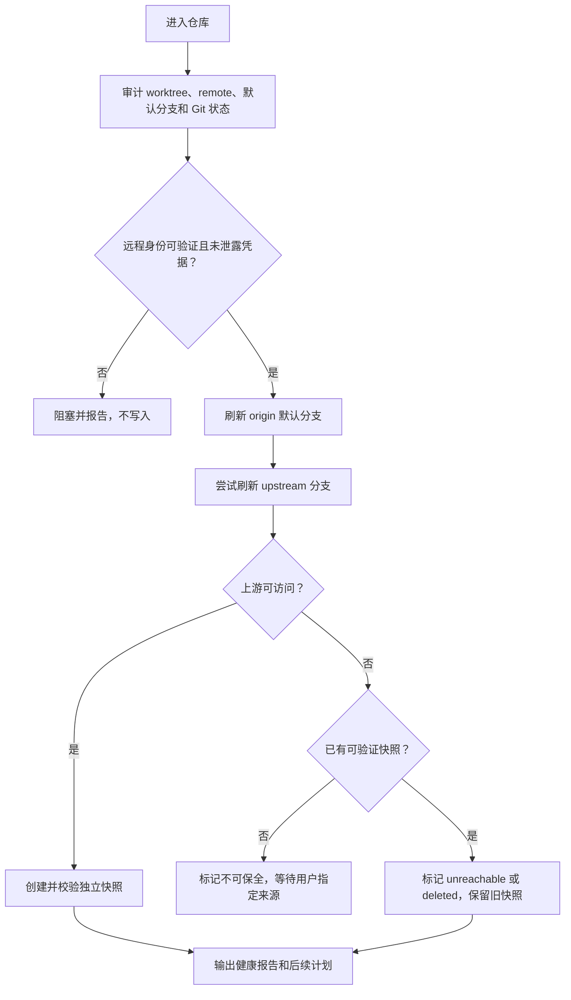
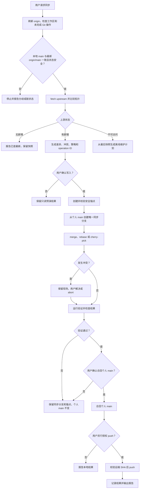

# Fork Repository Maintenance Skill PRD

日期：2026-11-05
状态：提案（仅定义产品需求，尚不创建 Skill）

## 1. 背景

Fork 外部仓库通常有两个长期目标：一是在成熟项目的基础上增加小功能、修复问题或适配个人环境；二是在上游项目被归档、删除或长期失联时，保留一份可以继续维护的代码历史。两种目标都需要保留上游来源和个人改动，但“同步上游”和“保全项目”是不同的操作。

本 Skill 暂定名为 `fork-repository-maintenance`，用于以安全、可审计、可恢复的方式维护 Fork 仓库。它同时提供：

1. **下游开发模式**：在个人 `main` 上保留自己的改动，按需吸收 `upstream` 的更新。
2. **项目保全模式**：保存上游代码历史和引用的独立快照，即使上游不可访问，也能继续检查、创建分支和恢复工作。

## 2. 产品目标

1. 保留个人 Fork 的 `main` 作为个人集成主线，不默认重置、覆盖、强推或替换其中的个人提交。
2. 让上游同步成为可预览、可审查、可回滚的整合过程。
3. 为每个开发分支记录基线，使个人功能可以追溯到当时的个人 `main`。
4. 保存可独立验证的上游代码快照，明确最后成功抓取的提交、分支、Tag 和来源。
5. 在上游被删除、归档或暂时不可访问时，允许从最后快照继续维护，并清楚标记数据新鲜度和限制。
6. 让所有会改变工作树、Git 引用、共享分支或远程仓库的操作在直接入口处经过显式确认和完整校验。

## 3. 非目标

- 不替代 Git、GitHub/GitLab 的账号、权限、PR 或 CI 管理能力。
- 不默认创建远程仓库、推送、合并 PR、修改保护规则、删除分支或执行强推。
- 不假设上游分支名为 `main`；分支映射必须通过远程元数据发现或由用户明确指定。
- 不自动解决代码冲突，也不在未审查的情况下选择冲突版本。
- 首版不保存 GitHub Issues、PR、Release、附件、Actions 运行记录等平台数据；首版保全范围是 Git 对象、分支、Tag 和必要的来源元数据。
- 不充当多 Fork 镜像服务、二进制制品仓库或发布渠道。

## 4. 核心概念与状态

### 4.1 远程角色

| 名称 | 角色 | 约束 |
| --- | --- | --- |
| `upstream` | 原始源仓库 | 只作为参考源，只 fetch，不向其 push。 |
| `origin` | 用户自己的 Fork | 承载个人 `main`、开发分支和协作 PR。 |
| `snapshot` | 外部保全存储 | 保存 Git 对象、引用和脱敏后的来源清单，不作为工作分支。 |

首次运行必须检查 remote 的 fetch URL、push URL、默认分支和可访问性。远程身份比较必须规范化协议、主机、路径和大小写规则；不能只比较原始字符串。报告和日志只能保存脱敏后的 URL、仓库身份摘要和 URL 指纹，绝不输出或持久化 userinfo、Token、密码、SSH 私钥或完整认证参数。若规范化后的 `origin` 与 `upstream` 指向同一仓库，或 `origin` 的 push URL 指向上游，必须阻塞并要求用户重新确认远程角色。

### 4.2 分支模型

```text
upstream/<default> ── fetch ──> 上游只读基线
       │
       │ 在同步分支中 merge / rebase / cherry-pick
       ▼
origin/main <──> 本地 main（已采纳上游 + 个人改动）
       │
       ├── feature/<topic>
       ├── fix/<topic>
       ├── chore/<topic>
       └── sync/upstream-<branch>-<sha>-<operation>

上游对象和引用 ── preserve ──> 外部 snapshot
```

- `upstream/<default>` 是最近一次成功 fetch 到本地的上游事实，不允许直接提交。
- 本地 `main` 和 `origin/main` 是不同对象：前者是工作分支，后者是最近一次 fetch 得到的远程跟踪引用。比较前必须先刷新 `origin`。
- 个人开发分支必须从当时的本地 `main` 创建，并记录基线提交。
- 默认同步策略是从个人 `main` 创建同步分支，再将上游变更合入；是否 rebase 由仓库策略和用户明确选择决定。
- 安全锚点必须记录完整 SHA、创建时间、操作 ID 和来源；不能只依赖一个可能被移动或复用的日期分支。

### 4.3 保全状态

每个来源应至少处于以下一种状态：

| 状态 | 含义 | 允许的后续操作 |
| --- | --- | --- |
| `active` | 最近一次来源检查和 fetch 成功 | 规划同步、创建快照、继续开发 |
| `archived` | 平台元数据或用户确认表明上游已归档 | 只读同步、从最后快照继续开发 |
| `unreachable` | 暂时无法访问，原因尚未确认 | 使用最后快照；重试检查，不得覆盖快照 |
| `deleted` | 来源确认不存在或远程永久失效 | 从最后快照恢复和继续维护 |
| `diverged` | `origin/main` 已被远端推进，或本地状态与预期基线不一致 | 先处理分歧，停止同步写入 |

`unreachable` 不得直接推断为 `deleted`。没有成功获取或验证的新快照时，既有快照和审计记录必须保留。

## 5. 目标用户与典型场景

| 场景 | 用户诉求 | Skill 应提供的结果 |
| --- | --- | --- |
| 首次接管 Fork | “帮我规范这个 Fork。” | 远程身份、默认分支、工作区和保全状态审计。 |
| 增加小功能 | “基于这个项目加一个功能。” | 从个人 `main` 创建开发分支，并记录基线。 |
| 例行同步 | “同步上游但保留我的改动。” | 刷新双方远程、差异预览、同步分支、冲突和验证报告。 |
| 项目保全 | “这个项目可能会消失，先保存下来。” | 创建、校验并记录独立 Git 快照。 |
| 上游消失 | “上游仓库没了，继续维护我的版本。” | 从最后快照恢复可用工作树和来源状态。 |
| 选择性采纳 | “只带入上游某个修复。” | 检查重复补丁、依赖和冲突，生成可审查的 cherry-pick 计划。 |
| 健康检查 | “这个 Fork 还能安全同步吗？” | 报告远程、漂移量、未推送提交、工作区、快照新鲜度和风险。 |

## 6. 功能需求（MVP）

### 6.1 仓库发现与健康审计

- 识别当前仓库、Git worktree、当前分支、HEAD、工作区状态和未跟踪文件。
- 枚举 `origin`、`upstream` 的 fetch/push URL，并输出脱敏后的规范化身份。
- 发现双方默认分支，支持 `main`、`master` 或显式映射。
- 健康检查前执行只读的 `fetch origin <default>` 和按需的 `fetch upstream <branch>`；任一 fetch 失败都必须标记为阻塞，不能用陈旧的 remote-tracking ref 判断安全。
- 计算个人 `main` 相对最新 `origin/<default>` 和 `upstream/<branch>` 的 ahead/behind、共同祖先、未推送提交、未提交改动和分支差异。
- 检查未完成的 merge、rebase、cherry-pick、revert、bisect、worktree 锁和浅克隆限制。
- 输出稳定的 JSON 和人类可读报告；报告包含完整 SHA、比较范围、脱敏来源、快照状态和阻塞项。

### 6.2 项目保全与快照

- 支持创建外部 Git bundle 或 bare mirror；保全模式必须使用显式引用集合抓取所声明的全部分支和 Tag，不能把只抓到一个目标分支的同步结果当作完整快照。
- 每个快照必须标记 `complete`、`partial` 或 `unknown`，列出未获取的分支、Tag、LFS 对象、子模块和平台数据；只有对象、引用和清单全部校验通过时才允许标记 `complete`。
- 每个快照必须包含：快照 ID、对象校验和、来源脱敏身份、抓取时间、各引用完整 SHA、默认分支、工具版本和创建结果。
- 快照写入使用临时目录、完整校验和原子发布；失败时不能替换已有快照。
- 快照默认存储在仓库外的 XDG 状态目录，例如 `$XDG_STATE_HOME/fork-repository-maintenance/<checkout-id>/`；用户可显式指定外部归档目录。快照目录和恢复目标必须通过真实路径、samefile、符号链接别名和父子包含关系检查，默认拒绝位于源工作树内或与源工作树重叠的路径。
- 支持列出、验证、比较和恢复快照；恢复前必须显示目标路径、来源 SHA 和可能覆盖的文件，默认不覆盖已有非空目录。
- 快照不可因一次失败的同步、远程不可访问或用户取消操作而自动删除。
- Git LFS、子模块、稀疏检出和附加 worktree 至少要报告存在及保全限制；不能把未获取的 LFS 对象或子模块仓库伪报为完整保全。

### 6.3 上游同步与整合

- 同步模式使用 `git fetch upstream --prune --tags` 或等价的目标引用集合更新上游基线，不直接改动当前工作分支；保全模式必须先获取其声明范围内的全部分支和 Tag，并将未获取范围写入快照状态。
- 同步前先刷新 `origin`，确认本地 `main` 与最新 `origin/main` 一致；远端已前进、工作区脏或存在未完成 Git 操作时停止。
- 显示上游新增提交、个人独有提交、变更文件摘要、共同祖先和潜在冲突风险。
- 默认生成带上游短 SHA 和唯一 operation ID 的 `sync/upstream-<branch>-<sha>-<operation>` 计划；已有同 ID 分支必须先验证来源和状态，禁止静默复用未知分支。
- 写入前创建并验证安全锚点，记录原 `main` SHA、上游 SHA、策略、时间和远程身份。
- 在同步分支中执行用户选择的 merge、rebase 或 cherry-pick；冲突时只保留现场并报告继续/abort 路径。
- 验证工作区、合并结果、用户指定或仓库可发现的测试，以及同步分支与 `origin/main` 的差异。
- 只有在用户确认后才合回个人 `main`；push 必须是另一次明确授权，并使用预期远端 SHA 的 lease 检查。
- 支持仅 fetch、仅预演、整合、继续冲突、取消整合、恢复锚点和幂等重试。

### 6.4 个人主线与开发分支

- 创建开发分支前验证本地 `main` 干净、没有未完成 Git 操作，并已基于最新 `origin/main`。
- 按可配置的 `feature/`、`fix/`、`chore/` 前缀创建分支，记录父提交和创建 operation ID。
- 审计开发分支与个人 `main` 的差距、是否已合并、未推送提交和最近上游基线。
- 协助生成 PR 或本地合并计划，默认不删除本地或远程分支。
- 对需要线性历史的仓库提供显式 rebase 选项，但不作为默认策略。

### 6.5 选择性上游采纳

- 按提交 SHA、PR 编号（平台工具已配置时）或上游 Tag 定位候选变更。
- 同时检查提交祖先关系和等价补丁：使用 `git cherry`、稳定 patch-id 或等价算法识别“不同 SHA 但已应用”的变更。
- 展示候选提交的依赖范围、目标分支、变更文件和冲突风险。
- 在独立维护分支中支持 `cherry-pick --no-commit` 审查模式；用户确认后才提交或合入个人主线。

### 6.6 审计、恢复与重试

- 每次写操作记录 operation ID、时间、原始 SHA、目标 SHA、策略、脱敏远程身份、快照 ID 和结果。
- 操作记录、快照清单和锁文件写入外部状态目录；不把凭据或未脱敏 URL 写入仓库。
- 支持查看最近操作、比较前后差异、从指定快照或锚点恢复，以及导出可放入 PR 描述的报告。
- 相同 operation ID 重试必须先验证已有分支、锚点、快照和当前远程 SHA；输入未变时继续原操作，不创建重复提交或重复快照。
- 远端分支意外前进、来源身份改变、快照校验失败或恢复前置条件不满足时停止，不默认 force-push、reset 或删除数据。

## 7. 关键工作流

### 7.1 首次接管与保全



首次运行只做审计和计划。补齐缺失 remote、改变跟踪配置、创建快照或创建分支都必须分别获得用户确认。

### 7.2 常规同步与恢复



### 7.3 上游消失或归档

1. 重新验证远程身份和访问结果；一次网络失败只能标记 `unreachable`。
2. 只有在平台元数据、持续失败和用户确认共同支持时，才标记 `deleted` 或 `archived`。
3. 选择最近一个完整且校验通过的快照，展示其来源 SHA、快照时间和缺失能力。
4. 用户确认后从快照恢复到新的工作目录或恢复分支，不能覆盖已有非空目录。
5. 恢复后的仓库继续使用 `origin` 作为个人维护远程；不把失效的 `upstream` 自动改写成其他 URL。

### 7.4 冲突与失败恢复

1. 禁止在存在未完成 merge、rebase 或 cherry-pick 时启动新的操作。
2. 报告冲突文件、双方相关提交、二进制/LFS/子模块项和可执行的继续或 abort 命令。
3. 用户解决后重新执行入口校验，再继续操作；校验必须发生在新的 `git add`、提交或引用写入前。
4. 验证失败时保留同步分支、锚点、快照和日志，个人 `main` 保持同步前状态。
5. 恢复失败时保留临时目录和已有快照，并报告恢复路径；不得静默清理唯一副本。

## 8. 安全、确认与直接入口

- **默认只读**：审计、刷新远程引用、差异分析和计划生成不写工作树；fetch 是唯一默认允许改变本地 Git 引用的操作。
- **逐项确认**：创建快照、创建/切换分支、merge、rebase、cherry-pick、commit、tag、push、修改 remote、恢复快照和删除临时数据前，必须说明目标、影响、源/目标 SHA 和恢复路径，等待明确确认。
- **直接入口自带门禁**：任何脚本直接调用都必须执行同样的状态、身份、路径和输入校验；不能假设调用者已经读过 `SKILL.md`。写入入口要求来自预演阶段的 operation token 或等价显式确认参数。
- **校验先于 mutation**：创建目录、锁、临时快照、分支、staging 文件或日志记录都算 mutation；所有必要输入必须在首次 mutation 前完成校验。
- **禁止默认危险操作**：不执行 `push --force`、`reset --hard`、删除分支、清理未跟踪文件、自动 stash、覆盖 remote URL 或删除唯一快照。
- **凭据边界**：只在 Git 自身需要时使用凭据；不读取、打印、持久化或传递 Token、密码、SSH 私钥和未脱敏 URL。
- **远程并发保护**：push 前重新获取目标远程 SHA，并使用 lease 或等价的 expected-old-value 检查；远端已前进时停止。
- **外部状态**：运行时日志、锁、快照清单和恢复证据默认位于外部 XDG 状态目录；仓库内仅保存用户明确要求纳入版本控制的配置。所有状态、快照和恢复目标都必须拒绝同源路径、符号链接别名、大小写别名和互相包含的危险布局。

## 9. 建议的 Skill 形态

实现时采用“便携流程说明 + 确定性脚本 + 按需参考”的结构，避免只依赖自然语言命令。目录必须遵循仓库的 Skill 结构：

```text
skills/fork-repository-maintenance/
├── SKILL.md
├── README.md
├── README.zh-CN.md
├── CHANGELOG.md
├── agent-builds/
│   └── codex/
│       └── agents/openai.yaml
├── scripts/
│   └── fork_maintenance.py
├── references/
│   ├── branch-model.md
│   ├── preservation-and-recovery.md
│   ├── conflict-recovery.md
│   └── special-git-features.md
└── tests/
    └── fixtures/
```

脚本应支持 `--json`、`--dry-run`、稳定的非零错误码和显式 operation token。只读审计、计划、快照创建、同步、恢复和日志查询应有清晰的子命令；每个会写入状态的子命令都必须独立执行入口校验。运行时状态和快照默认不进入仓库，也不被 `sync-skills` 当作 Skill 副本同步。

## 10. 与现有能力的边界

- `source-version-train` 负责需求分支、版本集成分支、发布候选、打包、发布和 Tag；本 Skill 不接管发布列车。
- `sync-skills` 负责 Skill 文件副本、来源、构建产物、安装快照和回滚；本 Skill 不把 Git 仓库同步状态伪装成 Skill 副本关系。
- GitHub 原生 Fork Sync、`gh repo sync` 和第三方 Actions 可作为已配置平台能力，但不能替代本 Skill 的本地审计、凭据脱敏、快照校验和恢复门禁。
- 若用户只请求普通 Git 分支操作、版本发布或 Skill 副本同步，应路由到对应能力，不触发本 Skill。

## 11. 成功指标与验收标准

### 11.1 成功指标

- 用户可以在保留个人 `main` 提交的前提下完成一次上游同步，并得到完整差异报告。
- 用户可以在上游仍可访问时创建可验证的独立快照。
- 上游归档、删除或不可访问后，用户可以从最后完整快照恢复并继续创建开发分支。
- 所有影响共享分支、远程仓库或唯一快照的操作在执行前都被阻止或要求明确确认。
- 重试不会创建重复同步分支、重复快照、重复 cherry-pick 或重复远程写入。

### 11.2 最小验收场景

1. 上游新增提交、个人 `main` 已合入自有 feature：预演正确识别双方差异，整合后个人功能仍在历史和结果中可见。
2. `origin/main` 在本地引用之后前进：刷新后 Skill 停止同步，不覆盖本地或远端。
3. 工作区存在未提交改动或未完成 Git 操作：Skill 不切分支、不合并、不自动 stash。
4. 上游整合产生文本冲突：Skill 报告冲突，支持继续或 abort，个人 `main` 不变。
5. 上游提交已以不同 SHA 应用：Skill 通过 patch-id 或等价检查识别重复，不重复采纳。
6. 上游可访问：创建 bundle 或 mirror，校验对象、引用和清单，并能恢复到新的空目录。
7. 上游返回不可访问：状态先标记 `unreachable`；已有快照保持不变。
8. 上游确认删除或归档：从最后快照恢复，报告快照时间、来源 SHA 和未保全的平台数据。
9. remote URL 含认证信息：报告和日志中只出现脱敏身份，原始凭据不落盘。
10. 同一 operation 重试：复用已验证状态，不创建重复分支、快照或提交。
11. 仓库包含 LFS、submodule、稀疏检出或附加 worktree：显式报告限制，不伪报完整保全。
12. 只抓取一个上游分支或遗漏 Tag：快照标记为 `partial` 或 `unknown`，不能报告为完整保全。
13. `origin` 和 `upstream` 的规范化身份相同，或 push URL 指向上游：操作在首次 mutation 前阻塞。
14. 快照目录位于源工作树内、通过符号链接别名重叠或与恢复目标互相包含：操作被拒绝且已有快照不变。

## 12. 待决策项

- 快照默认采用 Git bundle、bare mirror，还是两者按仓库规模分层；建议 MVP 先支持 bundle，并保留 mirror 扩展点。
- 是否把 GitHub 归档/删除状态作为平台适配器；建议 MVP 以 Git 访问结果为主，平台 API 作为可选增强。
- 审计状态和快照是否支持用户指定外部归档根目录；建议默认 XDG 外部状态，允许显式导出。
- 默认整合策略是否固定为 merge，还是允许按仓库策略选择 rebase；建议默认 merge。
- 是否将自动定时保全纳入首版；建议先提供手动、可验证的 `preserve`，定时任务作为后续增强。
- 分支命名、测试命令、保护规则和快照保留期限采用仓库局部配置、用户全局配置，还是分层合并；建议仓库局部优先、用户全局兜底。

## 13. 下一步

在用户确认本 PRD 后，先确定快照格式、外部状态目录、配置优先级和脚本子命令；再初始化符合仓库结构的 Skill，实现只读审计和 `preserve` MVP，随后在临时裸仓库拓扑上验证同步、删除/归档恢复、冲突、重复补丁、凭据脱敏和幂等重试。
