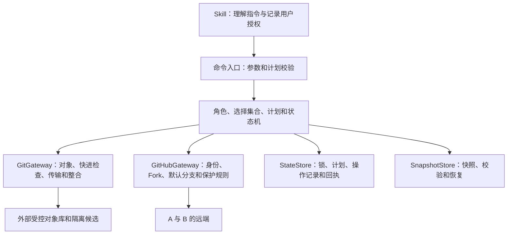
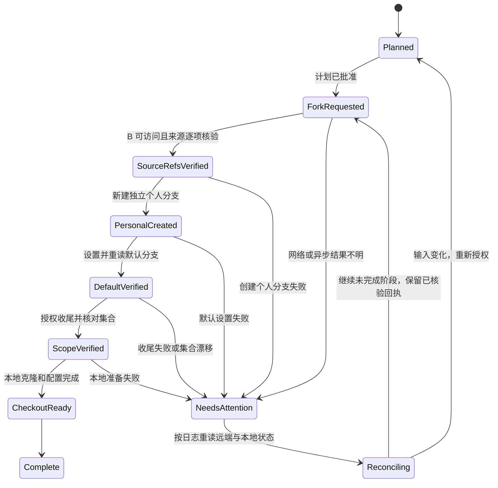

# Fork Repository Maintenance Skill 技术设计

日期：2026-11-05
状态：实施设计提案，尚未创建 Skill 或实现下述命令。
需求依据：[Fork Repository Maintenance Skill PRD](2026-07-29-fork-repository-maintenance-skill-prd.md)。

## 1. 设计范围与约束

本设计以最新版 PRD 的分支隔离模型为准：A 是上游，B 是 Fork；B 的来源分支与 A 严格同名，B 的个人默认分支必须另建。`sync` 只更新来源分支，`integrate` 才能改变个人版本。首版没有定时同步、Webhook 或后台同步服务。

文档中的文件结构、字段、命令和测试名称都是拟议接口。它们不能作为已有可执行工具调用。PRD 第 12.2 节尚未确定的项目，在本文中给出实施建议；建议不构成已发布兼容性承诺，实施前应定稿。

| 不变量 | 必须保证的行为 |
| --- | --- |
| I1：角色隔离 | 来源映射只允许 A/x → B/x；个人默认、个人功能、未登记分支不能被来源同步覆盖。 |
| I2：范围固定 | 单个、部分、全部展开为完整引用与 SHA；执行不能重新解释“全部”而扩大授权集合。 |
| I3：默认分支独立 | 默认分支名称与来源集合不冲突，只在初始化时复制基线；来源同步不修改其引用或平台默认设置。 |
| I4：来源仅快进 | 已有来源只接受预期旧 SHA 到计划 A SHA 的快进；新分支要求远端原先不存在。 |
| I5：可核验完成 | 远端重读与计划一致才推进成功基线；部分、超时、跳过和仅本地准备不等于全部成功。 |
| I6：失败可恢复 | 保存原始引用、操作日志和快照；不得自动回滚已成功远端写入或删除唯一副本。 |
| I7：入口自校验 | 直接命令、继续和恢复入口都校验角色、计划、路径、并发和依赖，不能依赖先运行 lint。 |
| I8：离线可恢复 | 本地快照恢复不依赖 A/B 可访问，不携带凭据，不宣称远端默认设置已完成。 |

## 2. 技术选择与模块

建议采用 Python 3.11+ 标准库编写控制程序，Git 负责对象、引用、传输与整合，GitHub 适配器通过当前登录的 `gh` 执行平台 API。拟支持 Git 2.45+；这只是实施目标，最低版本与当前版本必须在实现阶段分别验证。GitHub CLI 按所需 API、账号和字段能力预检，缺失时明确停止相关阶段。

`inspect --offline` 可在没有 gh 的情况下读取配置和清单；涉及 Git 对象、bundle 校验或恢复时仍要求 Git。不能把缺失依赖当成检查通过。首版平台写适配器仅实现 GitHub，其他托管平台保持只读识别或明确标为不支持初始化。



建议在 `scripts/` 中设置一个公开入口 `fork_maintenance.py`，内部按 `domain`、`selection`、`validation`、`git_gateway`、`github_gateway`、`state_store`、`snapshots` 分模块。公开入口与 `resume` 复用领域校验，传输模块只接收已验证的具体引用，不能自行补充通配符目标。

核心不依赖仓库外的 Python 包或项目相对导入。发布时按仓库 Agent adapter 构建，不在 portable SKILL.md 中写 Codex 安装路径；Codex 展示元数据属于 `agent-builds/codex/agents/openai.yaml`。

## 3. 数据模型与外部状态

### 3.1 身份和分支角色

`RepositoryIdentity` 包含 provider、host、不可变平台 repository ID、脱敏 owner/name、可安全展示的 URL。路径名称可能变化，不能用 URL 字符串相等替代仓库身份。A/B 相同或 B push 目标为 A 时拒绝。

创建尚不存在的 B 是唯一例外：计划用 host、目标 owner/name、当前账号和 expected-absent 约束目标，repository ID 暂为空。创建响应和来源核验后将不可变 B ID 绑定到操作回执，后续阶段必须使用这个 ID；不能因为同名仓库出现就认定它由本次操作创建。

Git 对象 ID 按仓库对象格式校验，不把所有 ID 写死为 40 位；每个事务拒绝不兼容的对象格式。分支统一保存完整 `refs/heads/<name>`，名称由 Git 规则验证，不做会改变身份的大小写或 Unicode 自动归一化。宿主文件系统不能区分的引用别名和 `foo`/`foo/bar` 冲突必须在落地前阻塞。

| 实体 | 主要字段 | 规则 |
| --- | --- | --- |
| RepositoryProfile | schema_version、profile_id、A/B 身份、personal_default、source_branches | profile_id 稳定，schema_version 是整数格式版本。 |
| PersonalDefault | name、initial_source_ref、initial_source_oid、created_oid、role、remote_setting_verified | role 固定为 personal-default；不属于来源映射。 |
| SourceMapping | mapping_id、name、role、initial_oid、last_verified_remote_oid、last_operation_id | role 固定为 source；A/B 名称相同。 |
| PersonalBranch | name、base_oid、purpose、role | role 为 personal；不因与后来出现的 A 分支同名而转为 source。 |
| Plan | operation_kind、scope、new_branch_policy、entries、protected_refs、profile_revision、digest、expires_at | 每个 entry 都有具体 A SHA、预期 B SHA/不存在、动作和角色。 |
| Operation | operation_id、plan_digest、stage、entry_results、receipts、recovery_paths | 先记录发送意图，远端核验后记录 verified。 |
| SnapshotManifest | snapshot_id、范围、引用映射、对象/文件摘要、角色、排除项、完整性 | 完整性限定声明范围，不能宣称完整平台备份。 |

来源映射的 `last_verified_remote_oid` 只在 B 远端核验后改变。个人整合的结果另记在个人分支操作中，不能推进来源同步基线。实际 B 默认分支设置与记录不一致时标记 `profile-drift`，来源写入先停止；修复是独立迁移。

### 3.2 文件布局和锁

```text
$XDG_STATE_HOME/fork-repository-maintenance/
  pending/<host-owner-name-request-hash>/
    creation-intent.json
    receipt.json
  repositories/<B-identity-hash>/
    profile.json
    profile.lock
    plans/<plan-id>.json
    operations/<operation-id>/
      operation.json
      events.ndjson
      receipts/
      recovery/
    cache/objects.git/
    candidates/<operation-id>/
    snapshots/<snapshot-id>/
      manifest.json
      history.bundle
```

未设置 XDG_STATE_HOME 时使用用户目录下的 `.local/state`。状态以 B 的稳定身份分组，使同一机器的不同 checkout 共享 B 的角色保护；不能只依赖 checkout 路径互相隔离后失去并发保护。配置、角色缺失或 schema 未知时，写入口停止，不按同名分支重建可信角色。

新建 B 之前的意图保存在 pending，按目标 host/owner/name 加锁。得到 B ID 后再取得 B 身份锁，将回执与正式 profile 关联，保留 pending 记录供中断恢复；该记录使用受校验的内部 ID，不用可逃逸的路径或符号链接跳转。两类锁按固定顺序获取。超时后无法证明创建归属时只核对和报告，不自动重复 POST 或清理同名仓库的分支。

建议状态文件用 JSON，事件用 NDJSON，目录采用用户私有权限。写文件通过同文件系统临时文件、flush/fsync 和原子替换；操作事件与 profile 更新若中断，以已持久化意图和远端重读恢复，不能靠时间戳猜测哪个 SHA 更新。

每个 B 使用一个宿主本地进程锁，更新 profile 时再次检查 revision；正常退出释放内核锁。重启后通过操作日志恢复，不按一个旧 PID 文件就认定操作仍运行。该锁只协调本机，跨设备仍依赖远端预期旧值检查；不承诺分布式全局锁。

自定义归档根目录需登记所有权。状态根下允许有属于本 profile 的快照和候选子目录；拒绝与用户源工作树、其他 profile、已注册快照或恢复目标发生危险重叠，不把所有父子目录一概判成非法。

### 3.3 配置与计划示例

仓库可选 `.fork-maintenance.json` 只存可共享偏好，如默认分支建议名和验证命令，不存本机路径、凭据或成功状态。用户级路径和偏好来自 XDG config。拟定优先级为单次显式参数 → 仓库偏好 → 用户偏好 → 内置默认；角色保护、远端保护规则和未授权删除不能被低层配置关闭。

下面是示意计划；SHA 和 ID 均为格式示例，不代表本仓库实际提交：

```json
{
  "schema_version": 1,
  "operation_kind": "sync",
  "scope": "selected",
  "new_branch_policy": "include-new",
  "profile_revision": 8,
  "personal_default_ref": "refs/heads/personal-main",
  "entries": [
    {
      "name": "main",
      "role": "source",
      "action": "fast-forward",
      "a_oid": "2222222222222222222222222222222222222222",
      "expected_b_oid": "1111111111111111111111111111111111111111"
    },
    {
      "name": "develop",
      "role": "source",
      "action": "create",
      "a_oid": "3333333333333333333333333333333333333333",
      "expected_b_oid": null
    }
  ],
  "excluded_refs": ["refs/heads/personal-main"],
  "verification": "remote-readback"
}
```

真实计划还必须包含完整 A/B 身份、操作者、保护引用的旧 SHA、创建/到期时间、profile 摘要和所有路径。对规范化 JSON（UTF-8、排序键、固定分隔、禁止重复键和 NaN）计算 SHA-256；摘要字段本身不参与摘要。集合排序和去重应在摘要前完成。

授权通过 `--approve-plan <digest>` 绑定计划，不从仓库配置自动读取批准值。该摘要用于限制执行输入，不是密码、签名或人类身份认证；CLI 无法证明持有者确为用户，调用方仍须取得真实用户授权。计划或源码 SHA、目标角色、账号、集合、路径发生变化时失效；同一已批准计划仅可恢复其未完成阶段。

## 4. 命令接口与统一入口边界

以下为拟议调用方式，尚不可执行：

已有仓库的命令必须显式选择 profile，或从已登记的当前 checkout 唯一解析；多个候选时拒绝猜测。新建 Fork 还必须提供 A、目标 B 和本地位置，以下示例为简洁省略这些公共参数。

```text
fork --scope single --branch release/5 --default-name my-main --default-base release/5 --dry-run
fork --plan <plan-file> --approve-plan <digest>
plan-sync --scope selected --branch main --branch release/5 --new-branches existing-only --json
plan-sync --scope all --new-branches include-new --json
sync --plan <plan-file> --approve-plan <digest>
integrate --source main --source-oid <oid> --target personal-main --strategy merge --dry-run
integrate --plan <plan-file> --approve-plan <digest>
preserve --plan <plan-file> --approve-plan <digest>
restore --snapshot <id> --destination <new-empty-path> --dry-run
restore --plan <plan-file> --approve-plan <digest>
resume --operation <id> --approve-plan <digest>
abort --operation <id> --approve-plan <digest>
inspect --offline --json
```

`single` 要求恰好一个分支，`selected` 要求非空显式集合，`all` 不接受另附分支名单。未知分支、非法引用和空集合按各动作契约拒绝；existing-only 过滤后为空可报告 no-op，但仍校验 profile 和排除角色，不登记新映射。未传 `--new-branches` 时为 existing-only。

`--dry-run` 不 mkdir、不创建锁/计划文件，不 fetch 新对象；允许远程只读查询。缺少本地历史时报告需要准备对象，不能假装完成祖先检查。在线 `plan-sync --refresh` 可在明确允许本地准备、完成静态校验后更新受控 cache；可选 `--save-plan <path>` 在路径校验后持久化计划。上述本地准备不包含 B 远端写授权。对 preserve、restore、integrate 和 fork，直接参数形式只允许 dry-run；写入必须提供对应类型的已批准计划。

| 入口 | 必须校验 → 首次写入 | 失败后应保留的状态 |
| --- | --- | --- |
| fork | 双方身份、范围、默认基线/名称、引导路径、权限、路径和授权 → 本地状态锁/操作意图，再发创建请求 | 已创建 B 和阶段回执；不得重复建仓或删除已复用资源。 |
| plan-sync --refresh/--save-plan | profile、全量选择、依赖、输出路径 → cache/计划文件 | A/B 工作分支不变；失败不发目标更新。 |
| sync | 所有静态 entry、角色、计划摘要、依赖和授权 → 锁/操作记录，再创建锚点 | 未选择和个人引用不变，成功项有回执，未知项待核对。 |
| integrate | 目标 role 必须为 personal-default 或 personal、来源已验证、基线、策略、测试授权和路径 → 锁/记录/候选 | 来源不变，原个人目标在验证和落地前不变。 |
| preserve | 声明范围、对象完整性、归档路径、授权 → 锁/记录/快照临时目录 | 既有快照不替换；失败保留可恢复 staging。 |
| restore | 清单、文件摘要、对象、空目标、别名和授权 → 状态记录/恢复 staging | 旧工作树和快照不变，部分新结果有明确路径。 |
| resume/abort | 解析原操作和阶段，重新调用所属动作校验 → 所属动作的首次写入 | 不允许借通用入口绕过 source/personal 区分或删除限制。 |

统一执行顺序为：解析全部输入 → 只读静态校验 → 验证计划和授权 → 取得本地锁 → 重读角色与远端预期 → 持久化执行意图 → 首次业务写入 → 核验 → 保存结果。任何早成功分支也必须检查 role、schema 和 profile revision。取得锁后的二次校验失败可以留下锁活动和失败日志，但不能改工作分支或远端；静态拒绝不得创建状态目录或锁。

## 5. 分支集合算法

规划阶段获取 A 的完整可见 `refs/heads/*` 清单并处理平台分页，读取 B 引用和 profile 中的角色。来源可见性不足时 all 不能声称覆盖所有不可见分支；完整集合以本次可见范围记录。

```text
requested = expand_scope(A_heads, scope, explicit_names)
protected = personal_default + all_registered_personal_refs

existing-only:
  candidates = requested ∩ registered_sources ∩ B_existing_heads
  absent/unregistered = skip with reason

include-new:
  registered + exists -> candidate fast-forward or no-op
  absent + name available -> candidate create
  exists + unregistered/personal -> blocker

for every candidate:
  require A.name == B.name
  require candidate not in protected
  require valid ref, no namespace/case alias conflict
  freeze A SHA and B expected SHA/absence
```

广义 all/existing-only 可以将不属于来源角色的引用报告为排除，但用户明确指定个人分支作为 sync 目标时直接拒绝，不能用空集合成功掩盖错误。include-new 出现角色碰撞是阻塞，不能悄悄跳过后报告全部完成。

A 删除分支时，在来源盘点中为 B 已有映射记录 source-missing 并保留基线；它不进入删除集合。B 丢失已登记来源分支时，existing-only 跳过；include-new 将恢复创建明确列入计划，并要求远端仍不存在。A 默认分支变更只产生来源元数据提示，不改 B 默认分支。

执行前校验整个集合；静态阻塞必须在第一次写入前报告。用户可以移除阻塞项后重新形成计划。执行期间一项遭遇远端竞争、网络错误或写保护失败，则逐项报告；若 profile/个人默认设置发生全局漂移，停止所有剩余写入。不会在运行中给计划补上新出现的 A 分支。

## 6. Fork 初始化与独立默认分支

### 6.1 基线选择

从计划时 A 的 default_branch 元数据取得分支名。若它在 requested 中，默认基线就是该选中 SHA；否则必须指定 `default_base` 且属于 requested。`personal_default.name` 必须是合法、空闲且与来源集合不冲突的名称，不把 A/default 的同名 B 分支直接设为个人默认。

显式 default_base 与上述优先规则冲突时拒绝计划，不能让参数覆盖“包含 A 默认分支时使用其副本”的产品约定。默认基线、默认名称和最终默认设置都要从 fork、resume 和直接初始化入口校验。

若个人名称恰好与平台临时引导分支同名，首版在预演时阻塞并要求换名；不自动搬移默认引用来规避冲突。复用 B 时必须核验 repository ID、Fork 来源和既有引用；缺少角色记录的引用需单独接管计划，不按同名推断所有权。

### 6.2 GitHub 分阶段实现

1. 身份和权限预检后，写入创建意图，通过 `POST /repos/{owner}/{repo}/forks` 创建 B。建议以 default_branch_only=true 作为最小引导，再显式导入 requested，以减少集合外分支；复用已有 B 时不重复 POST。
2. 创建请求是异步的，成功响应不等于对象已可读。以有界重试检查 B 身份、引用和对象；超时持久化阶段并退出，不重复建仓。重试中的等待不能无期限占用调用。
3. 用隔离对象库获取 A 选中引用，逐一验证计划 SHA。原生引导分支若与冻结 SHA 不一致，或 A 已推进，停止重新预演，不 reset B 迎合旧计划，也不静默接受新 SHA。
4. 对不存在的来源引用，以预期不存在条件创建 B/x；存在且相同可记录已完成，存在且未授权/不同则停止。来源成功状态经远端重读后登记。
5. 从已验证的 B/default_base SHA 创建另一条个人分支，核对其 SHA 后通过平台 API 将 B 默认分支设为该名称，再重读元数据。
6. 仅处理计划中明确授权的本次新仓引导分支：先保留回执/锚点，要求旧 SHA 未变、已非默认、保护规则允许，带预期旧值删除。复用资源不删除，删除失败不绕过保护。
7. 核对 B 最终 heads = 业务来源集合 + 独立个人分支 + 计划允许保留的既有个人资源；意外多出或缺少引用时初始化未完成。
8. 克隆到授权的新目录或核对已创建 checkout，配置 origin=B/upstream=A 和本地默认跟踪。克隆不等于 Fork；本地失败不能隐瞒远端已建仓或默认已设置。

GitHub 创建 API 只有 default_branch_only 范围开关，默认分支通过仓库更新 API 的 default_branch 字段设置，不能合并宣称为一个原子接口。[Create a fork](https://docs.github.com/en/rest/repos/forks#create-a-fork)、[Update a repository](https://docs.github.com/en/rest/repos/repos#update-a-repository)

平台默认设置的更新接口没有与 Git 引用事务统一的 expected-old 条件。本地锁不能约束其他管理员：设置前后必须核对默认名与角色，发现并发漂移就停止并报告已发生的结果，不自动切回旧值。初始化期间需要避免其他操作者同时修改默认设置，不能承诺这种跨 API 变更具有全局原子性。



状态机的简图不允许重跑已完成写入。reconcile 根据持久化阶段跳转具体下一步，已经设置的默认分支或已创建的来源要先核验，不重复创建。初始化失败不会自动删除整个 B，也不撤销用户或他人的后续提交。

## 7. 来源同步的引用事务

### 7.1 对象准备与祖先检查

操作在外部受控对象库进行，不 checkout B 的个人默认分支。按显式 refspec 获取来源到操作私有命名空间，禁用隐式 Tag 抓取、宽泛 refmap 和删除传播；Tag 保全使用独立选择和命名空间。不能使用 git push --mirror 或 --all 更新 B。

必须获取足够历史，避免浅历史造成错误祖先判断；对象不可获取时失败。祖先检查关闭本地 replacement refs 和 grafts，使用已核验对象，不允许依赖任意 alternates 作为独立可恢复证据。来源、目标引用只按计划解析，不能让全局 push 默认值决定目标。

已有分支要求：B_remote == mapping.last_verified_remote_oid == plan.expected_b_oid，并且 `merge-base --is-ancestor(expected, desired)` 返回 0。返回 1 是分歧，其他非零是校验失败，两者都不能进入发送。新分支要求远端不存在，并验证名称与所有个人角色不冲突。

### 7.2 compare-and-swap 与 fast-forward 同时成立

来源同步先独立证明快进，再通过显式旧值 lease 约束远端竞争。传输语义示例：

```text
existing:
  git push --porcelain
    --force-with-lease=refs/heads/<name>:<expected-oid>
    <verified-B-transport> <desired-oid>:refs/heads/<name>

create:
  git push --porcelain
    --force-with-lease=refs/heads/<name>:
    <verified-B-transport> <desired-oid>:refs/heads/<name>
```

这些是参数语义示例，实际以参数数组传给 subprocess，不通过 shell 拼接。只允许显式 `<ref>:<expected>` 形式；空 expected 表示引用必须不存在。lease 本身允许符合旧值的历史替换，所以不能替代前置祖先检查；Gateway 对 source role 再次断言快进且拒绝 `+refspec`、裸 --force 和省略 expected 的 lease。[git-push](https://git-scm.com/docs/git-push)

首次业务写入前记录原引用锚点和发送意图，锁定 desired 对象。每次只发送一个已校验引用，首版不承诺整批原子性。远端保护规则拒绝直接写入时返回 blocked；不能自动改保护、改成有 merge commit 的 PR 或换身份绕过。可提示用户采用符合原 SHA/快进契约的人工路径后重新核验。

本地受控引用通过带旧值的 update-ref 或事务更新，不直接写 `.git/refs`。这些本地事务不能与平台 API 或远端 push 组成全局原子事务。[git-update-ref](https://git-scm.com/docs/git-update-ref)

### 7.3 发送结果与远端核验

```text
Planned -> Validated -> Prepared -> SendIntent -> Sent -> RemoteVerified -> StateCommitted
                                      |           |
                                      +--timeout--+-> Uncertain -> Reconcile
```

SendIntent 包含 A/B、完整引用、旧/新 SHA 和个人默认分支观察值。发送后重新读取 B 的该引用和默认设置：

- B == desired：内容可核验完成，再持久化结果和成功基线；不能仅凭 push 进程 exit=0。
- B == expected：请求未生效或未完成，保留发送意图；确认无不明在途请求、输入未变后才恢复。
- B 为第三个 SHA、引用消失或默认设置漂移：标记冲突，停止继续写入，不强推补救。
- 查询失败：保持 uncertain，不推进成功基线，不盲目重复发送。

个人默认分支若由其他协作者并发推进，记录 external-change，不归因于本次 sync，也不尝试恢复旧 SHA。命令必须证明自身目标集合未含个人引用；事后相等检查不能替代写前角色保护。

远端已核验成功但 state 写入失败时返回 uncertain/state-persist-failed，保留 durable 发送意图和可用回执。resume 先重读再补状态，不能再次推送或把成功项回滚。all 模式汇总每条 entry 的结果，不把部分成功折叠为一个成功布尔值。

## 8. 个人版本整合

`integrate` 的目标 role 必须是 personal-default 或 personal，不能是任一来源引用。来源选用 B 已核验来源分支的指定 SHA；缺少该版本时提示先做手动 sync，不隐式跨动作获取和更新 B 来源。

先记录个人旧 SHA、选中来源 SHA、需保留功能、策略、测试命令和写入授权，再在隔离候选中处理。merge 默认保留个人历史；rebase 明确补丁范围与 merge commits 处理方案；cherry-pick 结合祖先/patch-id 检查并记录替代关系。

冲突时保存三方内容和功能意图，按“迁移、等价替代、保留旧行为、放弃功能”给出方案。ours/theirs 的含义与整合策略有关，不能按 A/B 名称一键选择。rebase 每次继续前核对当前操作和基线，直到全部提交结束再验证。

验证分为 Git 整合完成、构建、上游关键行为、个人功能和配置迁移。仓库提供的测试命令作为可执行代码审查；只运行已获授权的命令数组，结果须绑定候选 SHA。没有可执行验证时标记 unverified，不把“无冲突”当兼容成功。

共享个人目标更新遵守远端保护，并在落地前复核旧 SHA。若 rebase 候选不包含旧个人目标，首版只允许另建个人维护线或更新明确未发布的本地个人分支；不强推已发布个人默认分支，不自动切换默认设置。个人整合失败不改变来源引用或来源成功基线。

仍在 merge/rebase/cherry-pick 中才能执行相应 abort；整合完成但测试失败时仅修复或保留/放弃候选，不能对原个人目标 reset。候选也不自动删除，后续清理须基于所有权、保留证据和明确授权。

## 9. 快照与离线恢复

建议 MVP 先支持完整、自包含 bundle，mirror 作为后续缓存实现；这项选择仍需对齐 PRD 的最终决策。快照从受控对象库显式导出选中的 A 来源、B 来源和 B 个人引用，采用隔离命名空间并在 manifest 中记录原名映射，避免 A/main 与 B/main 相互覆盖。

清单含 schema_version、SHA 算法、引用列表、原始角色、B 个人默认名称、范围声明、排除项、bundle 文件摘要、对象校验结果和来源时间。声明范围之外的分支、平台数据、LFS 或子模块分别标记；Git 范围完整不代表完整可构建备份。

保存顺序：验证路径/范围 → 创建操作日志与 staging → 写 bundle 和清单 → 在新的无 alternates 的空对象库检查 bundle 前置条件和完整性 → 导入并逐引用核对 → fsync → 发布到新的 snapshot-id 目录。bundle verify 单独通过不能代替独立恢复试验；增量 bundle 缺少前置对象不能标为自包含。[git-bundle](https://git-scm.com/docs/git-bundle)

不替换已存在 snapshot-id，不在失败后删除唯一副本。归档根和状态路径必须检查 symlink、case alias、同 inode、包含关系和所属 profile；单纯使用字符串前缀或 resolve 结果不足以解决写入时路径竞争，应在打开/发布时再次核验并采用支持平台上的 no-follow/排他创建。

restore 不查询远端也能执行：先验证 manifest 全量结构、SHA、引用映射、文件摘要、无逃逸路径、无缺失必要对象，再校验新的空目标及所有权。经批准后在目标同文件系统 staging 导入 B 引用、选择清单中的个人默认为本地 HEAD，再发布恢复目录。A 引用保留为来源证据，不混入 B 的个人角色。

恢复配置不复制 credentialed URL、hooks 或可执行仓库配置；只按安全清单恢复来源身份，认证继续交给用户已有 Git 凭据机制。离线本地默认 HEAD 正确不等于远端 default_branch 已设置，结果字段保持 remote-setting-unverified。发布或恢复失败保留 staging、快照和具体恢复指引，不覆盖旧工作树。

## 10. 错误、结果和退出码

所有 JSON 输出包含 schema_version、operation_id（只读可为空）、operation_kind、status、entries、blocked_reasons、recovery_paths、next_action。stderr 与保存的日志均脱敏。result 必须区分 remote_verified 与 local_prepared。

| 退出码（拟定） | 状态 | 调用方行为 |
| --- | --- | --- |
| 0 | completed 或经校验的 no-op | 可报告具体动作完成，不扩展为别的阶段成功。 |
| 2 | invalid-input/invalid-plan | 修正输入，未进入业务写入。 |
| 3 | blocked | 角色、身份、保护或依赖冲突；按原因重新计划，不自动修复。 |
| 4 | partial | 已有部分远端核验成功，查看逐项回执，仅恢复未完成项。 |
| 5 | uncertain 或 state-persist-failed | 先 reconcile，不重复发送。 |
| 6 | execution-failed/recovery-failed | 根据当前阶段及 recovery_paths 恢复，不删除现场。 |

进程信号或崩溃可能没有 JSON；下一次启动从 durable intent 判断中断阶段，不能把没有最终文件当成“什么都没做”。unknown schema、无效清单、缺依赖和权限不足不降级为成功。

## 11. 安全、平台与兼容边界

- 使用 subprocess 参数数组、完整引用和明确 Git cwd；拒绝选项注入和非法引用，不从分支名或配置拼接 shell 脚本。
- 受控对象库不复制来源 hooks 或危险配置；source sync 不运行仓库构建脚本。个人整合测试执行前另行审查，远端保护始终有效。
- URL 指纹对脱敏身份计算，禁止将凭据哈希当安全替代品。运行时使用 Git/gh 既有认证，不抓取或复制 Token 到日志、计划和 bundle 配置。
- 全局角色保护、schema 全量验证和计划校验覆盖 no-op、resume、abort、restore、输出路径和报表；不允许后面的坏记录留下可供写入的部分可信映射。
- 首版可先验证 macOS/Linux；Windows 在锁、排他发布、路径身份和候选调用完整验证前，不宣称支持写操作。报告须区分平台未实现与检查通过。
- 浅克隆、子模块、LFS、稀疏检出和 worktree 逐项报告。保存 Git 历史与引用不能替代保存外部依赖、LFS 内容或平台附件。

## 12. 实现测试矩阵与需求映射

以下均为实现阶段必须增加的回归，当前只完成技术契约检查，不表示用例已经实现或执行。

| 拟议用例组 | 对应 PRD 验收项 | 重点证据 |
| --- | --- | --- |
| F01 fork-selection/default | 1–5 | 非默认单分支、部分、全部；默认基线缺失、同名/层级冲突、异步创建、引导清理、默认设置失败与恢复。 |
| S01 scope/no-auto | 6–11 | 无指令不更新；single/selected/all × existing-only/include-new；空交集、新分支、计划后新分支及个人 SHA 不变。 |
| S02 roles/concurrency | 12–17 | 同名 personal、未登记来源、B 变化、A 改写/删除/改名、静态拒绝无写、运行中部分失败、回执未知和重试。 |
| I01 integration | 18–23 | sync 与 integrate 隔离、三方冲突、多次 rebase、无冲突但测试失败、共享目标禁止强推、重复 patch、操作现场隔离。 |
| P01 offline/identity | 24–25 | A/B 不可访问时可恢复；同仓与 push 指上游拒绝；日志、指纹、Git stderr 无凭据。 |
| P02 paths/snapshots | 26–30 | 同路径/符号链接/大小写别名、双向包含；篡改 manifest/bundle、缺前置对象、LFS/子模块限制、无授权不创建目录、恢复角色。 |

每个写入口覆盖拒绝、成功和第二次幂等运行；共享校验须同时从直接调用、resume、abort 和 no-op 路径证明执行。错误对象/后置坏记录也要断言目标、未选分支、默认设置、状态和快照集保持预期。

测试夹具使用隔离 bare A/B 和空用户目录，禁用生产凭据。平台写入用可控 GitHub adapter fixture 模拟 API 和分页；真实 GitHub 新建/默认设置/保护用例只在显式授权的测试仓库执行，若未执行须标为未验证，不能由 mock 覆盖宣称真实平台兼容。

祖先与传输使用真实 Git 验证，包括预期旧值竞争、新分支创建竞争、源 refs 改写、replacement/grafts、Git/gh 缺失和受控 PATH。快照需在删除源对象库后从独立文件恢复；保留/恢复失败注入必须验证仍有可恢复副本。

未来 Skill 完成后，对每个受影响 adapter 构建并复制到源码树外，验证只依赖声明运行时。文档阶段不创建空 Skill、测试壳或假运行结果来满足此矩阵。

## 13. 实施拆分与本轮覆盖账本

### 13.1 实施顺序

1. 领域类型、严格配置解析、身份/角色、集合算法和纯预演，先证明个人默认分支不能成为 source target。
2. 外部状态、锁、不可变计划、操作意图和只读 reconcile；再接入源对象准备与逐引用来源同步。
3. GitHub Fork 初始化、独立默认设置与最小引导收尾，用同一角色与传输边界连接后续 sync。
4. 自包含快照和离线恢复，明确 manifest 角色与默认设置未核验状态。
5. 独立 integrate、冲突适配和候选验证；最后完成 adapter 分发、双语指南和完整回归矩阵。

状态存储、远端写入与恢复契约必须协同设计，但应按上述边界分别评审。上线前确定配置 schema、状态迁移、API 权限、支持版本和错误码；不在实现提交中悄悄改变 PRD 的分支模型。

### 13.2 本轮文档检查范围

本轮对象是配套 PRD 与本技术设计，属于文档变更。精确 Git base/head 和最终 gate 结果在提交后的执行报告中记录，避免在文档内写入其自身提交 SHA。下表的 PASS 仅表示契约一致性检查，运行时测试全部属于后续实现证据。

| 不变量 / 入口 | 场景与检查 | 本轮证据 | 限制 |
| --- | --- | --- | --- |
| I1/I3：fork、sync、integrate、resume | 同名来源、另建默认、include-new 碰撞、直接入口角色保护 | PASS：对照 PRD 4.2–4.5、6.2–6.4 与本文 3–8 节逐项核对 | 无运行时实现，未执行真实角色写入用例。 |
| I2/I4：scope 与 source 传输 | 两个选择维度、集合冻结、快进加显式旧值、新分支不存在 | PASS：PRD 命令例与本文 4/5/7 节、授权路径一致 | Git 传输语义依据官方文档；拟议 Gateway 尚未测试。 |
| I5/I6：fork/sync/resume | 异步创建、默认设置失败、远端未知、部分成功、状态落盘失败 | PASS：状态机、结果字段和回执恢复契约已列出 | 平台写 API、故障注入和跨设备竞争未运行。 |
| I7/I8：preserve/restore | 静态拒绝先于写入、路径别名、快照校验、离线恢复 | PASS：正文入口表、快照算法和需求测试矩阵一致 | N/A：本轮没有可执行路径/递归/缺依赖入口，非运行测试。 |
| 文档结构和版本 | 链接、JSON 示例、Mermaid 代码块、目录和 catalog | 使用相对链接/结构检查、git diff --check、skill_catalog --check；结果见提交执行报告 | 不新增 Skill，不变更 core/adapter/artifact 版本，无运行时 changelog 发布。 |
| 全仓门禁 | clean committed tree 上运行 tests/pr-review-gate.sh 对 exact base | 结果以最终执行报告为准，不把旧 head 的通过当作新 head 通过 | 门禁通过不证明计划中的 Skill 功能已实现。 |

## 14. 官方依据与待验证范围

核对日期为 2026-11-05。以下链接支持 Git 和 GitHub 的外部语义；其余状态机、命令、数据格式和默认策略是本项目设计选择。

- [GitHub Fork API](https://docs.github.com/en/rest/repos/forks#create-a-fork)：default_branch_only 和异步创建；接口没有任意分支名集合参数。
- [GitHub 仓库更新 API](https://docs.github.com/en/rest/repos/repos#update-a-repository)：default_branch 设置；实际账号需具备相应权限。
- [Git push](https://git-scm.com/docs/git-push)：显式 expected lease、空 expected、新引用与远端拒绝语义。
- [Git update-ref](https://git-scm.com/docs/git-update-ref)：带旧对象值的引用更新和本地事务。
- [Git bundle](https://git-scm.com/docs/git-bundle)：自包含/有前置条件的 bundle 与可达对象范围。
- [Git rebase](https://git-scm.com/docs/git-rebase)、[Git merge](https://git-scm.com/docs/git-merge)：个人整合、冲突处理与历史语义。

Git 2.45+、Python 3.11+、macOS/Linux 和当前 GitHub/gh 适配是拟议验证目标，不是本轮已完成的平台认证。实施时需固定测试版本和 API 配置，补齐真实平台证据再声明兼容。
