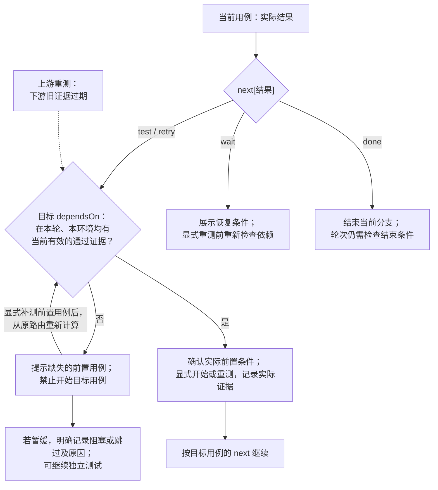

# CI Package Test

语言：[English](README.md) | **简体中文**

`ci-package-test` 串联 CI 测试包、基于 PR 的用例和可复用网页测试工作台，适用于不同平台和分发渠道。工作台组织版本、方案、轮次、环境/设备、执行记录及批注。普通 CI 只归档产物，对外发布须明确要求。初始版本仍为 `0.0.1`。

## 如何使用

```text
通过 CI 打测试包，并根据这个 PR 准备回归用例。
完善测试流程，以可复用网页展示用例、轮次、环境和测试结果。
支持网页内保存批注，以及 Codex 浏览器原生批注联调，保留摘录、回复和处理状态。
声明用例依赖：本轮、本环境的 LOGIN01 和 CART01 均通过后才能开始 PAY01。
明确通过、失败、部分执行、阻塞或跳过之后具体测什么，并区分环境阻塞与产品失败。
用机器可读的状态机管理用例执行，向 AI 导出当前状态、事件历史和允许的下一步。
复用现有工作台准备下一轮：失败优先，每轮包含全部冒烟，再纳入发布 PR diff 得出的用例。
把 Web 构建放到指定测试环境执行，逐条记录浏览器及配置。
把 CI run <run-id> 已验证的产物发布到指定分发渠道。
```

完整测试流程或网页展示请求会交付能运行的网页工作台，优先复用已有实现，没有时使用附带的[模板](assets/workbench/)。仅打包请求交付产物；安装、执行、测试环境部署和对外发布按要求开展。支持构建变体的项目默认使用 Release。

模板支持版本/方案/轮次导航、多选测试类型、失败及冒烟项纳入、环境登记、带时间的观察记录、冻结轮次定义、JSON 导入导出及用例定位链接。数据保存在当前浏览器的 IndexedDB；多人协作需接入项目服务端。复制模板后可运行 `python3 -m http.server 4317 --bind 127.0.0.1 --directory <工作台目录>`。初始工作台为空，应导入实际变更生成的方案，不能把演示结果当成测试证据。

批注可以关联用例、具体字段或执行记录，保留引用文字及当时的原文快照，支持回复、标记已处理、重新打开，并随归档保存。浏览器原生批注通过稳定链接、DOM 上下文及“复制原生批注上下文”联调；发送到聊天由宿主提供，核对后可按“原生批注录入”存入工作台，不会自动发送聊天或回写。详见[批注说明](references/annotations.md)。

新轮次遵循“草稿 → 就绪 → 执行中 → 已结束”，每个用例/环境独立记录执行状态，开始、重测和结果保存都校验转换条件。事件保留操作者、时间及原始证据，轮次结束不代表全部通过。“导出 AI 状态快照”包含共享契约、原始归档、当前状态和允许的下一步。旧归档明确标为旧流程，不补造历史。详见[状态机说明](references/state-machine.md)。

用例可按结果明确指向另一条测试、重测、等待（包含恢复条件）或结束当前分支；网页和 AI 按环境展示具体目标步骤。已有失败在部分执行、阻塞或跳过后仍保留未解决标记，直到本环境复测通过。旧用例没有分支时会明确提示。详见[条件测试和结果含义](references/conditional-tests.md)。

`dependsOn` 声明必须先通过的前置用例，`next` 声明结果后的分支。工作台按依赖顺序准备，拒绝循环依赖，拦截条件未满足的开始操作，并明确显示缺少哪些前置用例。上游重测会使下游证据过期，需重新验证，原始记录完整保留。详见[用例依赖](references/dependencies.md)。

网页会展示可交互流程图：实线表示前置依赖，虚线表示结果路由，按所选环境显示当前执行状态、未解决失败及过期证据，并突出当前用例和实际建议的下一条测试。点击节点打开用例，不会开始或保存测试；图中环境选择与详情同步。下一步面板包含具体步骤和预期。方案定义和旧轮次不会补造状态机记录。

可选的 `testLocation` 提示展示应用、页面、进入路径及具名控件的定位方式和操作。“复制手机测试提示”会附带源码、轮次、环境和实际测试步骤，方便人工或设备控制器接续操作。提示须与当前设备界面核对，不代表测试通过，也不会自动操作手机。可在当前用例定义中编辑，历史轮次保留原提示。详见[测试定位与设备交接](references/test-location.md)。

### 路由与依赖流程

把必须通过的条件放在**目标用例的 `dependsOn`**，通过 `next` 到达目标时也遵循同一规则。例如，LOGIN01 通过后指向 PAY01，而 PAY01 要求 LOGIN01 和 CART01 都通过。CART01 未通过时，先提示完成 CART01，不会自动记录结果或修改已配置的路由。详见[组合定义示例](references/dependencies.md#where-to-put-the-condition)。



打开目标仅切换页面；开始和保存结果时会再次校验。若执行期间前置证据发生变化，应记录阻塞或停止原因，恢复后重新开始。没有 `next` 时仍明确标为未配置。根据另一条用例的结果选择不同目标属于另一种路由能力，当前格式不支持跨用例条件表达式。

详细说明见 [SKILL.md](SKILL.md)、[网页交付](references/web-workbench.md)、[CI 与发布](references/ci-and-publication.md)和[测试轮次](references/test-rounds.md)。仓库中运行 `node --test skills/ci-package-test/tests/*.test.mjs` 验证模板，需要 Node.js 18+。改名时保留原来的不可变同步 ID。

## 何时触发

- 移动端、桌面、Web、服务或库项目的 CI 测试包交付。
- 与 PR/代码变更及确定产物关联的回归用例。
- 创建、完善或使用包含方案、轮次、环境和记录的可复用网页测试流程。
- 同一流程的后续执行或明确要求的产物发布。

## 何时不触发

- 不涉及 CI 或测试工作台的纯本地打包。
- 不涉及测试包交付或流程管理的基础设施修改。
- 无关网页，或不涉及实际测试流程的 QA 理论讨论。
- 未要求的源码版本修改、分支晋级、修复、PR 创建、合并或标签操作。
