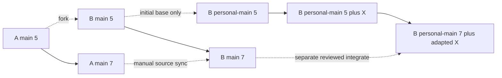

# Branch roles

The source A/x maps only to B/x. B's independently created default (for example
personal-main) and personal feature/maintenance branches are not source targets.
Source synchronization cannot merge or rebase personal work. Accidental personal
commits on a source branch block sync; preserve them on a personal branch first.

Select single, selected, or all upstream heads. existing-only updates the selected
registered intersection; include-new may create absent corresponding heads.
Neither grants permission to adopt existing unregistered branches, change roles,
delete B branches missing upstream, or alter the personal default setting. Plans
freeze SHA and selection: upstream branches created later need another plan.

If A's default is selected, its copied SHA is the initial personal base. Otherwise
the user selects a base from the copied sources. Always create a new personal
branch; names colliding with the native bootstrap default must be changed before
initialization. Native GitHub forking only exposes default/all creation; the CLI
then imports explicit heads and removes only an authorized unchanged bootstrap
head created by that operation. Reused repositories with extra heads require an
explicit migration; the initializer does not clean them up.

Source sync publishes each branch using a verified fast-forward plus an explicit
expected-old lease. A lease does not by itself prove a safe fast-forward. The
personal integration workflow separately preserves history or creates a new
personal line; it never force-replaces a published personal default.
