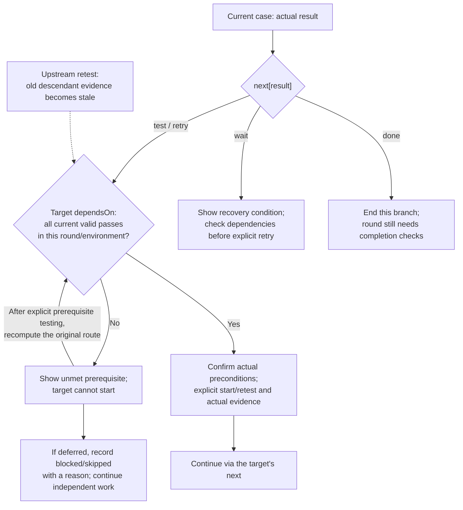

# Test Workbench

Language: **English** | [简体中文](README.zh-CN.md)

`test-workbench` manages a reusable web testing process with standardized cases, execution records and revision-bound summaries. It organizes versions, plans, rounds, environments/devices, dependencies, next-test guidance, Issue evidence and annotations, and connects CI packages and PR changes across platforms when requested. Ordinary CI archives artifacts; external publication requires an explicit request. Current Skill version: `0.0.4`.

## How To Use It

```text
Build a test package through CI and prepare regression cases for this PR.
Improve our testing process and display cases, rounds, environments and results in a reusable web workbench.
Use GitHub Issues as the default test-data source, or explicitly use Git-tracked definition and record files.
Support saved web comments and Codex browser-native annotations, with excerpts, replies and resolution status.
Express case prerequisites: require LOGIN01 and CART01 to pass before PAY01 in this round/environment.
Define what to test next after pass, failure, partial execution, blocking or skipping; distinguish blockers from product defects.
Use machine-readable state machines for cases/executions and export current states, event history and allowed next actions for AI.
Use the existing workbench for the next round: failures first, all smoke cases, then cases from the release PR diff.
Prepare the web build in the specified test environment and record browser/configuration with each result.
Publish the verified artifact from CI run <run-id> to the specified distribution channel.
Preserve our ADB device picker, historical-device associations, WebMCP tools and PR-diff preparation when improving the existing workbench.
Keep our selected screenshot storage, one-file-per-round/current-result policy and conclusion-tab behavior instead of replacing them with starter defaults.
```

Requests to implement a complete test process or web display deliver a working web workbench, reusing an existing implementation or adapting the bundled [template](assets/workbench/). Assessment/explanation requests return findings and examples; design requests return a proposal. They do not themselves start a site, CI, test-data writes or device operations. Build-only requests produce artifacts. Installation, execution, environment deployment and external publication follow the requested scope. Build defaults follow the explicit user choice, applicable project instructions and documented test-package mode, with Release as the supported fallback.

Version 0.0.4 clarifies [execution quality and acceptance](references/execution-quality.md): check samples/scenarios and actual duration before accepting a pass, verify App/firmware/schema combinations, and retain required checks and applicable environments. Reuse existing runners with case-level result mapping, comparable measurements and project bench setup/cleanup. These are agent procedures; automatic report parsing, combination checks, sparse applicability, metric comparison and resource control require verified project adapters. The bundled runtime and persisted data formats remain unchanged, with no migration of old records.

Version 0.0.2 adds [project integration procedures](references/project-integrations.md) for ADB device discovery, explicit imported-device identity associations, live AI/WebMCP operations, real GitHub PR comparison, selected local screenshot upload/preview and project storage/conclusion presentation. These procedures preserve existing project capabilities; the starter does not implement those adapters. Each requested adapter needs shared validation and actual verification before being reported available. Existing custom formats require an explicit migration adapter. One file per round is distinct from history retained inside it; an explicitly selected current-results-only policy must not be described as managed append-only history. Issue attachments remain the default for new integrations; existing local screenshot workflows are retained until a migration is requested.

The template supports version/plan/round navigation, multi-type cases, failure/smoke selection, environment registration, timestamped observations, immutable round definitions, JSON import/export and deep links. Run `node scripts/workbench-server.mjs --repo OWNER/REPO` from the Skill directory (Node18+ and authenticated gh). For files use `node scripts/workbench-server.mjs --mode repository-files --repo-root /absolute/project --data-dir testing/testflow`. Open the printed URL, verify the target and initialize a new workspace before saving. Copy both scripts and workbench assets together when adapting the template. It starts empty: import a plan based on actual changes, not demonstration results.

Case definitions, execution records and test summaries follow one [unified data format](references/data-format.md), regardless of storage. Both adapters reconstruct the same validated archive; the webpage renders its state-machine projections rather than inferring results from Issue text or labels. The specification lists required fields, enums, references, source mappings and complete runnable examples. Use `node scripts/validate-test-data.mjs --archive archive.json --conclusions conclusions.json` for read-only validation of exported data (Node.js18+, no Git/gh/network required).

Annotations can target a case, a field or an execution record; they retain the quoted text and original snapshot, support replies and resolve/reopen events, and are included in archives. Browser-native tools use the stable link/DOM context and a copy-context button. Sending a native annotation to chat is provided by the host; confirmed comments can be recorded in the workbench as native-origin annotations. There is no automatic chat send or writeback. See [annotations](references/annotations.md).

New rounds follow draft → ready → running → completed; executions are tracked separately per case/environment, with explicit start/retest and guarded outcomes. Events retain actor, time and original evidence. Ending a round does not mean all passed. **Export AI state snapshot** includes the shared contract, original archive, current states and allowed next actions. Older archives remain explicitly legacy; no history is fabricated. See [state machines](references/state-machine.md).

Cases can define explicit outcome branches to another test, retry, wait (with a recovery condition), or end that branch. The webpage and AI show the concrete target procedure per environment. Known failures remain unresolved through partial/blocked/skipped retests until a passing retest. Older flat cases show missing routing explicitly. See [conditional tests and outcome meanings](references/conditional-tests.md).

Use `dependsOn` for required prerequisite cases and `next` for outcome branches. The workbench orders prerequisites, rejects cyclic dependencies, blocks ineligible starts and exposes exactly which cases are missing. Upstream retests make downstream evidence stale until revalidated; original records remain intact. See [dependencies](references/dependencies.md).

The webpage shows an interactive flow graph: solid prerequisite edges, dashed outcome routes, current per-environment states, unresolved failures/stale evidence, and selected/next-case highlights. Click a node to open its test without starting or saving it; graph and detail environment selection stay aligned. The next-test panel includes concrete steps and expected results. Definitions and legacy rounds do not fabricate managed execution states.

Optional `testLocation` hints show application/page, entry path and named control locators/actions. **Copy phone test hints** includes source/round/environment context and the actual procedure for a person or device controller. Hints require a live-screen check; they never prove a pass or trigger a phone command. Edit them in the current definition; historical rounds retain original hints. See [test location and device handoff](references/test-location.md).

The Skill has **two authoritative data-source modes**: **GitHub Issues by default** for a new project, or **repository-tracked files** when explicitly selected. Existing projects retain their recorded choice. Both modes use the same state machines, dependencies, flow graph, next-test guidance and annotations. File mode keeps case definitions and execution records in separate files; Issue mode does not require two primary JSON files in Git. Browser data/exports are caches or backups. See [source selection, file layout and migration](references/data-sources.md). Both webpage adapters are included through a loopback-only service; credentials stay in gh. File saves create working-tree changes; **Commit test data** separately commits only owned test files. The webpage displays revision-bound test conclusions, saved with supporting records and included in file-mode commits. Conclusions do not approve a release. Explicit browser preview/old IndexedDB export remains available via `?local=1` or the original `?workspace=<name>` URL; it never silently replaces the primary source.

File mode also links new or existing execution records to one or more GitHub Issues. Enter full Issue URLs when recording a result, or expand **Link Issue** on an existing record. Screenshots and logs go directly in the Issue; the webpage has no separate attachment entry. Associations are appended to `records.json` and included in explicit Git commits, webpage links and AI/conclusion references. Original observations and outcomes stay unchanged. A failed result requires notes and an associated Issue (older evidence fields remain supported). Links are declared references: existence, access and attachments must be checked in GitHub. Linking does not create/comment/close an Issue or synchronize status. See [record-to-Issue associations](references/data-sources.md#record-to-issue-associations).

In the [GitHub Issues mode](references/github-issues.md), multi-user concurrency and strict remote history protection are explicitly deferred for an initial single-operator flow, while existing local guards remain. CLI image/video attachments require **gh 2.99.0+** and `--attach` in the actual command's help. For older/missing support, upgrade through the existing installation channel (Homebrew: `brew upgrade gh`) when authorized, recheck capabilities/account, or use browser upload. Logs/text/ZIP files use browser attachments or a separately verified adapter even on newer CLI versions. Ordinary CI/text tasks are not subject to this optional media version gate.

### Routing And Prerequisite Flow

Declare a required pass on the **target's `dependsOn`**, including when that target is reached through `next`. For example, LOGIN01's passed branch targets PAY01, while PAY01 requires both LOGIN01 and CART01. Until CART01 passes, guidance identifies CART01 first; it does not record a result or change the configured route. See the [combined definition example](references/dependencies.md#where-to-put-the-condition).



Opening a target only navigates. Start and result saves validate again; if prerequisite evidence changes during execution, record why execution was blocked/stopped and restart after recovery. A missing `next` remains unconfigured. Selecting different targets based on another case's result is a separate routing capability; the current format has no cross-case predicates.

See [SKILL.md](SKILL.md), [web delivery](references/web-workbench.md), [CI and publication](references/ci-and-publication.md) and [test rounds](references/test-rounds.md). Template tests: `node --test skills/test-workbench/tests/*.test.mjs` from this repository (Node.js 18+). Renamed from `ci-package-test`; the immutable sync ID `android-ci-fir-test`, existing `ci-package-test/*` protocol identifiers and browser database keys stay unchanged, so existing data needs no migration.

## When It Triggers

- CI test-package delivery for mobile, desktop, web, services or libraries.
- Regression cases tied to a PR/change set and exact package.
- Creating, improving or operating a reusable web testing process with plans, rounds, environments and records.
- Follow-up execution or explicitly requested publication in this workflow.

## When It Does Not Trigger

- Local-only packaging without a CI or test-workbench task.
- Infrastructure changes without test-package delivery or process management.
- Unrelated websites or QA theory without an actionable testing workflow.
- Unrequested source version changes, branch promotion, fixes, PR creation, merges or tags.

For an existing project UI, preserve its navigation and integrations while making full case editing, frozen next-step previews, a round-wide annotation list and read-only AI export easy to find. See [UI adoption and acceptance](references/ui-adoption.md). The bundled template uses tighter header/card spacing and marks the selected view; a project can retain separate conclusion, coverage and flow tabs.
