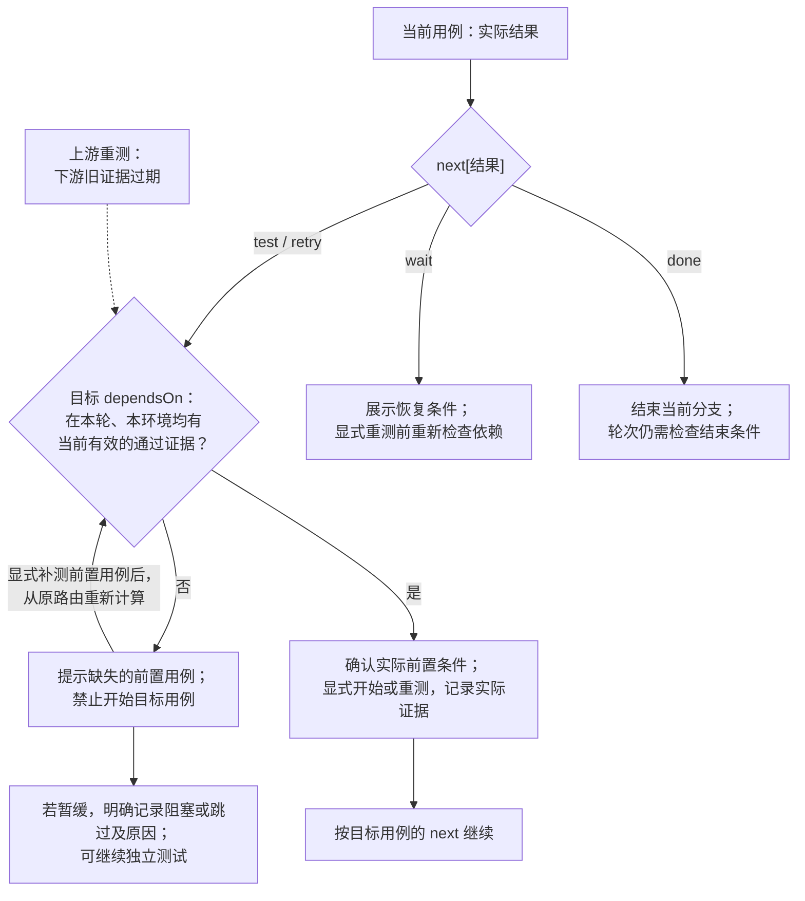

# Test Workbench（测试工作台）

语言：[English](README.md) | **简体中文**

`test-workbench` 管理可复用的网页测试流程，统一测试用例、执行记录与绑定数据版本的测试总结。工作台组织版本、方案、轮次、环境/设备、用例依赖、下一步测试、Issue 证据及批注，并在需要时衔接不同平台的 CI 测试包和 PR 变更。普通 CI 只归档产物，对外发布须明确要求。当前技能版本：`0.0.2`。

## 如何使用

```text
通过 CI 打测试包，并根据这个 PR 准备回归用例。
默认以 GitHub Issues 为测试主数据源，或者明确选择将用例定义与执行记录分文件纳入 Git。
完善测试流程，以可复用网页展示用例、轮次、环境和测试结果。
支持网页内保存批注，以及 Codex 浏览器原生批注联调，保留摘录、回复和处理状态。
声明用例依赖：本轮、本环境的 LOGIN01 和 CART01 均通过后才能开始 PAY01。
明确通过、失败、部分执行、阻塞或跳过之后具体测什么，并区分环境阻塞与产品失败。
用机器可读的状态机管理用例执行，向 AI 导出当前状态、事件历史和允许的下一步。
复用现有工作台准备下一轮：失败优先，每轮包含全部冒烟，再纳入发布 PR diff 得出的用例。
把 Web 构建放到指定测试环境执行，逐条记录浏览器及配置。
把 CI run <run-id> 已验证的产物发布到指定分发渠道。
完善现有工作台时，保留 ADB 手机选择、历史设备关联、WebMCP 工具和真实 PR 差异准备。
沿用项目选择的截图存储、每轮单文件/只保存当前结果规则及结论 tab 行为，不直接替换为模板默认值。
```

完整测试流程或网页展示请求会交付能运行的网页工作台，优先复用已有实现，没有时使用附带的[模板](assets/workbench/)。仅打包请求交付产物；安装、执行、测试环境部署和对外发布按要求开展。支持构建变体的项目默认使用 Release。

0.0.2 补充了[现有项目接入规范](references/project-integrations.md)：ADB 手机发现、明确确认的历史设备身份关联、AI/WebMCP 实时操作、真实 GitHub PR 差异准备、按项目选择的本地截图上传/预览，以及存储和结论展示规则。这些规范用于保留、接入项目已有能力，自带模板尚未实现这些适配器；实际接入后须通过共享校验和验证，才能报告功能可用。已有自定义格式需明确迁移适配。“每轮一个文件”与“文件内是否保留历史”是两回事；用户选择只保留当前结果时，不宣称具备完整追加事件历史。新项目仍默认把附件放入 Issue，已有本地截图流程保留到用户要求迁移为止。

模板支持版本/方案/轮次导航、多选测试类型、失败及冒烟项纳入、环境登记、带时间的观察记录、冻结轮次定义、JSON 导入导出及用例定位链接。在 Skill 目录运行 `node scripts/workbench-server.mjs --repo OWNER/REPO`（Node18+，gh 已登录）。文件模式运行 `node scripts/workbench-server.mjs --mode repository-files --repo-root /项目绝对路径 --data-dir testing/testflow`。打开输出的本机地址，核对目标后初始化新工作台。移植时需一起复制脚本和网页资源，保留相对目录。初始工作台为空，应导入实际变更生成的方案，不能把演示结果当成测试证据。

测试用例、测试记录和测试总结统一遵循[数据格式规范](references/data-format.md)，文件与 Issue 共用同一套字段、状态枚举和 ID 引用。两种适配器还原为同一份经过校验的归档，网页按状态机投影展示，不从 Issue 自由文本或标签推断结果。规范包含必填字段、存储映射及可运行的完整示例。可用 `node scripts/validate-test-data.mjs --archive archive.json --conclusions conclusions.json` 只读校验导出数据（Node.js18+，无需 Git、gh 或网络）。

批注可以关联用例、具体字段或执行记录，保留引用文字及当时的原文快照，支持回复、标记已处理、重新打开，并随归档保存。浏览器原生批注通过稳定链接、DOM 上下文及“复制原生批注上下文”联调；发送到聊天由宿主提供，核对后可按“原生批注录入”存入工作台，不会自动发送聊天或回写。详见[批注说明](references/annotations.md)。

新轮次遵循“草稿 → 就绪 → 执行中 → 已结束”，每个用例/环境独立记录执行状态，开始、重测和结果保存都校验转换条件。事件保留操作者、时间及原始证据，轮次结束不代表全部通过。“导出 AI 状态快照”包含共享契约、原始归档、当前状态和允许的下一步。旧归档明确标为旧流程，不补造历史。详见[状态机说明](references/state-machine.md)。

用例可按结果明确指向另一条测试、重测、等待（包含恢复条件）或结束当前分支；网页和 AI 按环境展示具体目标步骤。已有失败在部分执行、阻塞或跳过后仍保留未解决标记，直到本环境复测通过。旧用例没有分支时会明确提示。详见[条件测试和结果含义](references/conditional-tests.md)。

`dependsOn` 声明必须先通过的前置用例，`next` 声明结果后的分支。工作台按依赖顺序准备，拒绝循环依赖，拦截条件未满足的开始操作，并明确显示缺少哪些前置用例。上游重测会使下游证据过期，需重新验证，原始记录完整保留。详见[用例依赖](references/dependencies.md)。

网页会展示可交互流程图：实线表示前置依赖，虚线表示结果路由，按所选环境显示当前执行状态、未解决失败及过期证据，并突出当前用例和实际建议的下一条测试。点击节点打开用例，不会开始或保存测试；图中环境选择与详情同步。下一步面板包含具体步骤和预期。方案定义和旧轮次不会补造状态机记录。

可选的 `testLocation` 提示展示应用、页面、进入路径及具名控件的定位方式和操作。“复制手机测试提示”会附带源码、轮次、环境和实际测试步骤，方便人工或设备控制器接续操作。提示须与当前设备界面核对，不代表测试通过，也不会自动操作手机。可在当前用例定义中编辑，历史轮次保留原提示。详见[测试定位与设备交接](references/test-location.md)。

Skill 支持**两种主数据源模式**：新项目默认使用 **GitHub Issues**；明确选择时使用**纳入 Git 的文件**。已有项目沿用其已记录的选择。两种模式共用状态机、用例依赖、流程图、下一步测试提示和批注。文件模式将测试用例定义与测试执行记录分文件保存；Issue 模式不要求在 Git 中再维护两份主数据 JSON。浏览器数据和导出仅作为缓存或备份。参见[模式选择、文件布局和迁移](references/data-sources.md)。已内置两种网页读写适配器，通过仅监听本机的服务连接，凭据留在 gh。文件模式保存到工作区，再由“提交测试数据”单独提交，仅纳入工作台自己的数据文件。网页展示绑定记录版本的测试结论，结论与依据一起保存，文件模式提交时也包含结论；测试结论不代表发布批准。旧 IndexedDB 数据可通过 `?local=1` 或原来的 `?workspace=<name>` 地址明确进入预览并导出，不会自动替代主数据源。

文件模式也支持为新增或已有测试记录关联一个或多个 GitHub Issue。新增记录时填完整 Issue 链接，或展开已有记录的“关联 Issue”。截图和日志直接放在 Issue 中，网页不再提供单独的附件入口。关联信息追加保存在 `records.json`，随显式 Git 提交入库，并显示为网页链接及 AI/结论引用。原始记录和结果保持不变。失败须填写备注并关联 Issue（旧记录的证据字段仍兼容）。链接仅表示声明的关联，存在性、权限和附件内容需在 GitHub 确认；关联不会创建、评论或关闭 Issue，也不联动状态。详见[记录关联 Issue](references/data-sources.md#record-to-issue-associations)。

在 [GitHub Issues 模式](references/github-issues.md)下，初期按单人顺序操作，**多人并发与严格的远端历史保护暂不处理**，现有本地校验保留。CLI 上传图片/视频要求 **gh 2.99.0+**，并确认实际命令帮助中有 `--attach`。版本过低或缺少参数时，在已授权范围内通过原安装渠道升级（Homebrew：`brew upgrade gh`），复查能力和账号；无法升级则改用 GitHub 网页上传。即使版本足够，日志、文本和 ZIP 仍走网页附件或另行验证的适配器。普通 CI 和文本操作不受此可选媒体功能的最低版本限制。

### 路由与依赖流程

把必须通过的条件放在**目标用例的 `dependsOn`**，通过 `next` 到达目标时也遵循同一规则。例如，LOGIN01 通过后指向 PAY01，而 PAY01 要求 LOGIN01 和 CART01 都通过。CART01 未通过时，先提示完成 CART01，不会自动记录结果或修改已配置的路由。详见[组合定义示例](references/dependencies.md#where-to-put-the-condition)。



打开目标仅切换页面；开始和保存结果时会再次校验。若执行期间前置证据发生变化，应记录阻塞或停止原因，恢复后重新开始。没有 `next` 时仍明确标为未配置。根据另一条用例的结果选择不同目标属于另一种路由能力，当前格式不支持跨用例条件表达式。

详细说明见 [SKILL.md](SKILL.md)、[网页交付](references/web-workbench.md)、[CI 与发布](references/ci-and-publication.md)和[测试轮次](references/test-rounds.md)。仓库中运行 `node --test skills/test-workbench/tests/*.test.mjs` 验证模板，需要 Node.js 18+。由 `ci-package-test` 改名而来；不可变同步 ID `android-ci-fir-test`、已有 `ci-package-test/*` 协议标识和浏览器数据库名称均保留，原有数据无需迁移。

## 何时触发

- 移动端、桌面、Web、服务或库项目的 CI 测试包交付。
- 与 PR/代码变更及确定产物关联的回归用例。
- 创建、完善或使用包含方案、轮次、环境和记录的可复用网页测试流程。
- 同一流程的后续执行或明确要求的产物发布。

## 何时不触发

- 不涉及 CI 或测试工作台的纯本地打包。
- 不涉及测试包交付或流程管理的基础设施修改。
- 无关网页，或不涉及实际测试流程的 QA 理论讨论。
- 未要求的源码版本修改、分支晋级、修复、PR 创建、合并或标签操作。

完善已有项目 UI 时，保留现有导航和集成，并让完整用例编辑、固定步骤的下一步预览、整轮批注列表、只读 AI 状态导出容易找到。见 [UI 适配与验收](references/ui-adoption.md)。内置模板收紧顶部与卡片间距并标识当前视图；项目可继续使用独立的结论、设备覆盖、流程图 Tab。
